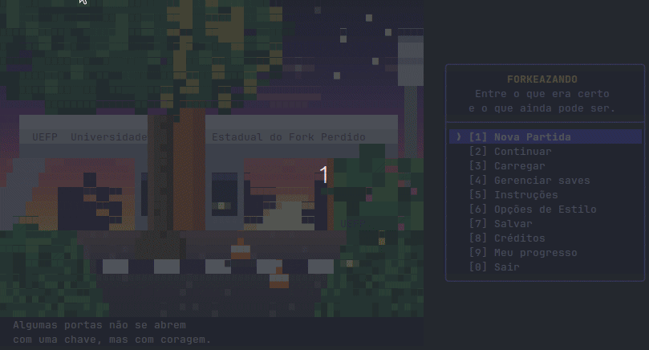

# Forkeazando

<p align="center">
  
</p>

<p align="center">
  <strong>Entre o que era certo e o que ainda pode ser.</strong>
</p>

<p align="center">
  Um jogo narrativo interativo sobre a vida universitária, as escolhas que fazemos e as consequências que carregamos.
</p>

<p align="center">
  
  
  
  
</p>

---

Forkeazando é um jogo narrativo interativo desenvolvido em Java para a disciplina **MI-Programação**, que segue a metodologia PBL (*Problem-Based Learning*), da Universidade Estadual de Feira de Santana (UEFS).

A história acompanha uma estudante de Engenharia de Computação ao longo de sua trajetória universitária. Entre disciplinas, projetos, relacionamentos, oportunidades e exigências institucionais, cada escolha pode abrir caminhos, limitar possibilidades e produzir consequências que se refletem nos capítulos seguintes.

A universidade é mais do que o cenário da história: é um ambiente de aprendizado, convivência, competição, adaptação e burocracia. O jogador precisa descobrir como lidar com suas próprias características, administrar recursos limitados e construir uma trajetória em um sistema que nem sempre reconhece o esforço da maneira esperada.

**Não basta escolher o que parece certo: é preciso lidar com as consequências do que foi escolhido.**

## Navegação

- [Sobre o jogo](#sobre-o-jogo)
- [Sistemas de jogo](#-sistemas-de-jogo)
- [Conquistas e colecionáveis](#-conquistas-e-colecionáveis)
- [Salvamento e continuidade](#-salvamento-e-continuidade)
- [Interface e controles](#-interface-e-controles)
- [Tecnologias](#-tecnologias)
- [Estrutura do projeto](#-estrutura-do-projeto)
- [Como executar](#-como-executar)
- [Fase 2](#-fase-2)
- [Limitações conhecidas](#limitações-conhecidas)
- [Versões](#versões)
- [Autoria](#autoria)

---

## Sobre o jogo

Forkeazando transforma a experiência universitária em uma narrativa interativa. A protagonista não chega à universidade como uma personagem sem história: sua formação anterior, sua situação econômica e suas características influenciam as condições iniciais da jornada.

O passado importa, mas não determina sozinho o futuro. As decisões tomadas durante a graduação também afetam os atributos da protagonista, suas relações com outros personagens, as possibilidades disponíveis e os desfechos que poderá alcançar.

Ao longo da história, o jogador precisa equilibrar diferentes dimensões da vida universitária:

- **Desempenho acadêmico:** desenvolver conhecimentos e demonstrar capacidade técnica.
- **Participação:** envolver-se nas discussões e nas atividades acadêmicas.
- **Energia:** administrar a disposição disponível para enfrentar as exigências da rotina.
- **Relacionamentos:** construir vínculos com colegas, veteranos, professores e outras pessoas da universidade.
- **Decisões e habilidades:** desenvolver características que podem abrir ou restringir opções futuras.
- **Adaptação institucional:** lidar com regras, procedimentos, prazos e exigências burocráticas.

Essas dimensões se relacionam. Uma escolha que favorece determinado aspecto da trajetória pode trazer custos em outro. O jogador precisa decidir quais oportunidades aproveitar, quais responsabilidades assumir e quais consequências está disposto a enfrentar.

### Uma trajetória moldada por escolhas

As escolhas não servem apenas para alterar o texto de uma cena. Elas podem modificar o estado da partida e influenciar as possibilidades narrativas posteriores.

O jogo utiliza atributos, relacionamentos e *flags* para representar características e decisões relevantes da jornada. Esses registros permitem que escolhas anteriores sejam consideradas em situações futuras.

Dependendo do estado da protagonista, determinadas alternativas podem estar disponíveis, enquanto outras podem exigir condições específicas ou permanecer inacessíveis.

O objetivo é fazer com que a trajetória construída pelo jogador tenha consequências ao longo da experiência, em vez de tratar cada cena como um episódio completamente isolado.

### A protagonista

A personagem principal é uma estudante de Engenharia de Computação cuja experiência universitária começa antes mesmo de sua primeira aula.

Sua situação econômica, sua experiência no ensino médio e suas características pessoais ajudam a definir seu ponto de partida. A partir daí, suas decisões e experiências constroem uma trajetória própria.

O jogo considera que estudantes diferentes podem chegar à universidade com recursos, expectativas e experiências distintas. Por isso, o contexto inicial faz parte da experiência narrativa, e não é apenas um detalhe de apresentação.

### A universidade como sistema

Em Forkeazando, as dificuldades não vêm somente das disciplinas ou das relações pessoais. Procedimentos, formulários, prazos, regras e comunicações institucionais também fazem parte da experiência.

A burocracia funciona como uma força recorrente na trajetória da protagonista: compreender as regras e aprender a navegar pelo sistema pode ser tão importante quanto desenvolver conhecimento técnico.

Essa dimensão dá ao jogo um conflito particular: a diferença entre aprender de verdade, participar da vida universitária e conseguir demonstrar isso dentro das estruturas que avaliam o estudante.

---

## 🎮 Sistemas de jogo

### Atributos e recursos

A protagonista possui recursos e características que influenciam a experiência de jogo.

- **Energia:** representa um recurso limitado, consumido por responsabilidades e atividades. Administrá-la é importante para decidir quais compromissos assumir. Quando chega a zero, a protagonista passa por um episódio de **esgotamento** (cenas 970 a 972). O jogo considera os vínculos e a vida social construídos até aquele momento para determinar se alguém percebe a situação e oferece ajuda ou se a protagonista enfrenta o episódio sozinha. Depois, a narrativa retoma o caminho que estava sendo seguido.
- **Score:** representa o desempenho acumulado segundo as regras do jogo e pode participar das condições de progressão e dos desfechos.
- **Participação:** representa o envolvimento da protagonista nas atividades e discussões acadêmicas, podendo influenciar as possibilidades disponíveis.
- **Características e habilidades:** registram aspectos da protagonista que podem habilitar alternativas específicas.
- **Relacionamentos:** representam os vínculos construídos com outros personagens.
- **Flags de decisões:** guardam informações sobre acontecimentos e escolhas relevantes para a continuidade narrativa.

Os recursos não devem ser interpretados isoladamente. Uma decisão pode ser vantajosa para um atributo e, ao mesmo tempo, impor custos ou consequências em outras dimensões da vida universitária.

### Cenas e escolhas

A narrativa é organizada em uma abertura e capítulos compostos por cenas e alternativas de decisão.

Durante a experiência, o jogador lê os acontecimentos, avalia as opções disponíveis e escolhe como a protagonista reage às situações. As consequências podem afetar o estado da partida e as condições de acesso a acontecimentos posteriores.

As escolhas são processadas pelo sistema do jogo, que mantém os atributos, as decisões e os demais dados necessários para dar continuidade à narrativa. Algumas opções exigem recursos ou condições específicas; por isso, nem todas estarão necessariamente disponíveis em todos os momentos.

### Finais e progressão

A trajetória pode conduzir a diferentes finais, de acordo com as condições e os acontecimentos registrados durante a partida.

O sistema de progressão permanente permite acompanhar os finais já alcançados, as conquistas desbloqueadas e os colecionáveis registrados. Esses dados ficam separados dos salvamentos individuais, possibilitando acompanhar a evolução do jogador entre diferentes jornadas.

---

## 🏆 Conquistas e colecionáveis

Forkeazando conta com sistemas de progressão que incentivam a exploração da experiência narrativa.

### Conquistas

As conquistas são desbloqueadas quando condições específicas são atendidas durante a jornada. O sistema registra os desbloqueios e permite consultar o progresso, incluindo conquistas ainda não obtidas.

O painel de conquistas apresenta o total e a porcentagem de conquistas desbloqueadas, além de indicar visualmente as conquistas obtidas e as ainda bloqueadas. Quando disponível, também exibe a descrição e a data de desbloqueio.

### Galeria de colecionáveis

O catálogo de colecionáveis permite acompanhar habilidades e itens adquiridos durante as partidas. A galeria usa slots ilustrados em pixel art para representar os conteúdos e diferencia visualmente o que já foi desbloqueado. Os nomes dos colecionáveis obtidos também são apresentados em texto.

A galeria registra os conteúdos obtidos e ajuda o jogador a visualizar o que já descobriu ao longo de suas jornadas.

### Histórico de finais

Os finais alcançados são registrados com data e hora. Assim, a conclusão de uma partida contribui para o histórico de progressão sem depender da permanência daquele estado em um slot específico.

---

## 💾 Salvamento e continuidade

Forkeazando possui um sistema de persistência em JSON que permite continuar partidas, manter configurações e registrar progressos entre execuções.

### Partidas

O jogo oferece três slots independentes de salvamento, com suporte a:

- Criação de uma nova partida.
- Continuação da partida mantida em memória.
- Carregamento de uma partida salva.
- Salvamento manual, com escolha do slot de destino e salvamento em toda em partida.
- Salvamento automático a cada 5 cenas concluídas e ao concluir a partida (arquivo `saves/autosave.json`, acessível por "Carregar autosave"). O autosave não substitui o salvamento manual: ao sair, o jogo ainda pergunta se deseja salvar em um slot.
- Confirmação antes de sobrescrever um slot ocupado.
- Menu "Gerenciar saves", com exclusão de saves e autosave mediante confirmação.
- Visualização de metadados de cada slot: nome da protagonista, capítulo, data e hora do salvamento, score, participação, rank e energia.
- Slots com arquivo danificado aparecem como "Corrompido" na lista, sem impedir o uso dos demais.

Os dados persistidos incluem o estado necessário para continuar a jornada, como capítulo e cena atuais, atributos, relacionamentos, habilidades e itens, decisões registradas (*flags*) e o final alcançado, conforme o modelo de estado do jogo. Os desbloqueios permanentes (finais, conquistas e colecionáveis) ficam no progresso permanente, descrito abaixo.

### Configurações persistentes

As preferências do jogador são armazenadas separadamente dos slots de partida.

Entre as configurações disponíveis estão:

- Velocidade de exibição do texto (Lento, Normal ou Rápido): define a pausa entre as linhas de diálogo.
- Volume.
- Confirmação de saída: quando desligada, o jogo não pergunta se deseja salvar ao sair, iniciar ou carregar outra partida.
- Exibição de dicas de atalhos.

Se o arquivo `saves/configuracao.json` estiver inválido, o jogo avisa e inicia com os valores padrão em vez de encerrar. Ao alterar as configurações, o arquivo é sobrescrito com valores válidos. Os valores lidos do arquivo passam pelos mesmos limites aplicados na tela de configurações.

> **Observação:** a configuração de volume está persistida, mas seu efeito depende da implementação atual do sistema de áudio.

### Progresso permanente

O arquivo `saves/progresso.json` mantém registros independentes dos slots de partida, incluindo finais, conquistas e colecionáveis.

Essa separação permite preservar o histórico de progressão mesmo quando uma partida é sobrescrita ou uma nova jornada é iniciada.

### Integridade dos dados

O sistema de persistência utiliza Gson para serialização e desserialização dos dados. Cada save é gravado em um envelope com a versão do formato e a data de salvamento, e saves antigos, sem esse envelope, continuam sendo lidos. Também contempla validação dos arquivos, exceções específicas para falhas de gravação e carregamento e o uso de arquivos temporários antes da substituição do destino, tanto nos saves quanto nas configurações.

As exceções personalizadas incluem:

```text
PersistenciaException
├── SaveException
├── CarregamentoException
└── DadosInvalidosException
```

---

## 🖥️ Interface e controles

Forkeazando é executado inteiramente no terminal, com navegação interativa por meio do JLine.

A interface reúne o menu principal, as cenas narrativas, os menus de configuração e salvamento e as telas de consulta de progresso. Os componentes de apresentação foram organizados para separar os dados do jogo de sua representação visual.

### HUD e informações da protagonista

Durante as cenas, o HUD apresenta o rank da protagonista, o indicador de pausa e barras visuais para energia, score e participação. As barras são atualizadas a partir do estado atual da personagem e agrupam informações relevantes sem substituir as regras que controlam a disponibilidade das escolhas.

### Ilustrações, retratos e animações

As cenas importantes têm ilustrações em pixel art, e os personagens que falam aparecem com retrato e expressão (neutra, feliz, séria ou triste). Tudo é desenhado no próprio terminal, com o caractere `▀`. Cada caractere representa dois pixels, com cores de 24 bits, sem depender de arquivos de imagem externos para desenhar as artes.

- Cada ilustração ocupa 66 colunas por 24 linhas, a mesma largura da caixa de cena, e a maioria é animada em 12 quadros. O último quadro é a arte estática.
- A arte só aparece em terminais com pelo menos 66 colunas e 30 linhas. Em terminais menores, o jogo segue normalmente, mas sem ilustrações e retratos.
- Os finais de carreira possuem ilustrações próprias, exibidas no início dos epílogos.
- Para desligar as animações, por exemplo, em terminais lentos, gravações de tela ou por acessibilidade, defina `FORKEAZANDO_SEM_ANIMACAO=1` antes de executar o jogo. As ilustrações passam a aparecer diretamente no quadro final.
- A associação entre cenas, ilustrações e retratos é definida em `roteiro/VisuaisDeCena` e `roteiro/VisuaisDeFinal`. Os desenhos ficam em `view/pixel`.

### Controles

| Tecla | Ação |
|---|---|
| `↑` / `↓` | Navegar pelas opções |
| `←` / `→` | Alterar valores quando disponível |
| `Enter` | Confirmar uma seleção |
| `P` | Pausar a exibição do texto de uma cena |
| `C` | Retomar a exibição do texto pausado |
| `0` | Retornar ao menu principal nas cenas que oferecem essa opção |

A entrada por setas depende de um terminal compatível com JLine. Em cenas ou menus que utilizam entrada numérica, as opções devem ser selecionadas digitando o número correspondente.

### Terminal compatível

Para a navegação por teclado funcionar adequadamente, recomenda-se executar o jogo em um terminal real, como o Terminal do Linux ou macOS ou o Windows Terminal, em vez do console de execução da IDE. As ilustrações exigem suporte a cores de 24 bits (*truecolor*), além do espaço mínimo descrito acima.

---

## 🛠️ Tecnologias

| Tecnologia | Utilização |
|---|---|
| Java 21 | Implementação da lógica, dos modelos e da interface |
| JLine | Captura de teclas e interação com o terminal |
| Gson | Persistência e recuperação de dados em JSON |
| Maven | Gerenciamento de dependências e ciclo de compilação |
| JUnit 5 | Testes automatizados |

O projeto utiliza a arquitetura MVC para separar as responsabilidades entre modelos, controladores e visualizações. Essa organização ajuda a manter a lógica da narrativa, o fluxo de interação e a apresentação no terminal em componentes distintos.

---

## 📁 Estrutura do projeto

```text
src/
├── main/
│   ├── java/
│   │   └── br/uefs/forkeazando/
│   │       ├── controller/    # Fluxo do jogo e dos menus
│   │       ├── dao/           # Persistência de partidas e progresso
│   │       ├── excecao/       # Exceções personalizadas
│   │       ├── model/         # Entidades e estado do jogo
│   │       ├── roteiro/       # Abertura, capítulos, cenas e escolhas
│   │       ├── view/          # Telas e entrada do teclado
│   │       │   └── widget/
│   │       │   └── pixel/     # HUD, ícones, ilustrações e animações
│   │       └── Main.java      # Ponto de entrada
│   └── resources/             # Recursos da aplicação
└── test/
    └── java/
        └── br/uefs/forkeazando/
            ├── controller/
            ├── dao/
            ├── model/
            ├── roteiro/
            └── view/
```

Os testes ficam em `src/test/java`. Os dados persistentes são armazenados em `saves/`, criada no diretório de execução do jogo.

---

## 🚀 Como executar

### Requisitos

- Java 21 ou superior.
- Maven 3.8 ou superior para execução a partir do código-fonte.
- Terminal compatível com JLine. Para exibir as artes, é necessário suporte a cores de 24 bits (*truecolor*).

### Executar o jogo

Na raiz do repositório:

```bash
chmod +x rodar.sh
./rodar.sh
```
```bash
mvn package
```
Se o arquivo JAR executável estiver disponível:

```bash
java -jar target/forkeazando.jar
```

> O comando com JAR pressupõe que o arquivo `forkeazando.jar` tenha sido gerado e esteja no diretório atual.

### Executar os testes

Na raiz do projeto, execute:

```bash
mvn test
```

A suíte automatizada cobre componentes de persistência e progressão (slots, autosave, exclusão, metadados e envelope dos saves, configurações), a decisão de saída, regras de disponibilidade das escolhas, o fluxo alternativo de esgotamento de energia e associações entre cenas e recursos visuais. Entre as verificações visuais estão a existência de artes para os finais, o uso das ilustrações cadastradas e o preenchimento dos pixels em todos os quadros das animações.

---

## 📋 Fase 2

A segunda fase amplia o jogo com recursos de continuidade, persistência, progressão permanente e gerenciamento das partidas.

- [x] Criação e continuação de partidas.
- [x] Três slots de salvamento.
- [x] Metadados das partidas salvas.
- [x] Salvamento manual na cena.
- [x] Salvamento automático.
- [x] Salvamento automático por progressão (a cada 5 cenas) e na conclusão da partida.
- [x] Escolha do slot ao salvar.
- [x] Exclusão do autosave.
- [x] Menu de gerenciamento de saves: 
- [x] Configurações que alteram o comportamento do jogo.
- [x] Carregamento de partidas.
- [x] Confirmação antes de sobrescrever um salvamento.
- [x] Confirmação antes de excluir um salvamento.
- [x] Configurações persistentes.
- [x] Registro permanente de finais.
- [x] Conquistas e conteúdos desbloqueáveis.
- [x] Persistência de colecionáveis e conquistas.
- [x] Exceções personalizadas de persistência.
- [x] Testes automatizados de persistência e validação do progresso.
- [x] Validação de integridade.
- [x] HUD com indicadores visuais de estado da protagonista.
- [x] Galeria pixel art de habilidades e itens.
- [x] Painel pixel art de conquistas.
- [x] Ilustrações, retratos e animações para cenas e finais.
- [x] Testes de regras do esgotamento e integridade dos recursos visuais.

### Limitações conhecidas

- O uso das setas depende de um terminal compatível com JLine.
- Em terminais com menos de 66 colunas ou 30 linhas, as ilustrações e os retratos não aparecem.
- As animações não podem ser puladas durante a exibição. Podem ser desligadas por completo com `FORKEAZANDO_SEM_ANIMACAO=1`.
- O caminho alternativo de gravação, utilizado quando não há suporte à movimentação atômica de arquivos, não possui cobertura específica nos testes automatizados.
- O autosave é um único arquivo, sem histórico: cada novo autosave substitui o anterior.

---

## Versões

| Versão | Principais mudanças |
|---|---|
| `v1.0.0` | Fase 1 |
| `v1.1.0` | Fase 2, sessão 1: salvamento em JSON e exceções personalizadas |
| `v1.2.0` | Fase 2, sessão 2: progressão, conquistas e colecionáveis |
| `v1.3.0` | Fase 2, sessão 3: ilustrações, retratos e animações em pixel art, menu animado, finais ilustrados e esgotamento quando a energia chega a zero |
| `v1.3.1` | Dicas de atalhos durante o jogo e atualização da documentação |
| `v1.4.0` | Fase 2, sessão 4: autosave por cenas, escolha de slot, gerenciamento de saves, configurações com efeito e tratamento de configuração inválida |

---

## Autoria

**Stheffanny Nascimento Alves**

Projeto desenvolvido para a disciplina **MI-Programação**, na Universidade Estadual de Feira de Santana (UEFS).