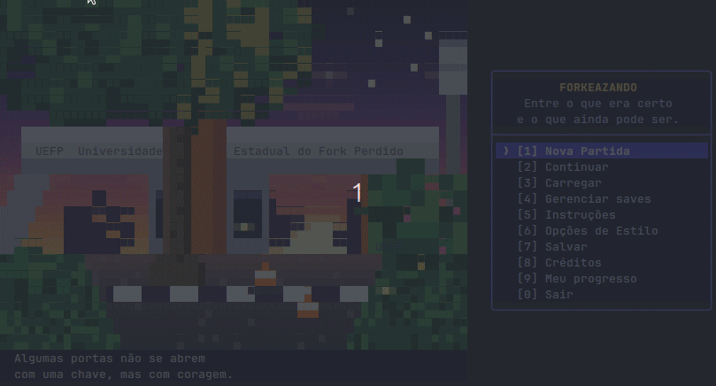

# Forkeazando

<p align="center">
  
</p>

<p align="center">
  <strong>Entre o que era certo e o que ainda pode ser.</strong>
</p>

<p align="center">
  Um jogo narrativo interativo sobre a vida universitária, as escolhas que fazemos e as consequências que carregamos.
</p>

<p align="center">
  
  
  
  
  
</p>

---

**Forkeazando** é um jogo narrativo interativo desenvolvido em Java para a disciplina **MI-Programação**, da Universidade Estadual de Feira de Santana (UEFS), seguindo a metodologia PBL (*Problem-Based Learning*).

A história acompanha estudantes de Engenharia de Computação na sua trajetória universitária. Entre disciplinas, projetos, relacionamentos, oportunidades e exigências institucionais, cada decisão pode abrir caminhos, restringir possibilidades e produzir consequências nos capítulos seguintes.

A universidade não é apenas o cenário: é um ambiente de aprendizado, convivência, competição, adaptação e burocracia. O jogador precisa administrar recursos, compreender as suas próprias características e construir uma trajetória num sistema que nem sempre reconhece o esforço da maneira esperada.

**Não basta escolher o que parece certo: é preciso lidar com as consequências do que foi escolhido.**

> **Estado do projeto:** a Fase 2 foi desenvolvida para terminal. A Fase 3, na branch `fase3`, está migrando a experiência para JavaFX. O menu principal e a tela de carregamento já possuem implementação inicial; a interface gráfica completa ainda está em desenvolvimento.

## Navegação

- [Sobre o jogo](#sobre-o-jogo)
- [Sistemas de jogo](#-sistemas-de-jogo)
- [Conquistas e colecionáveis](#-conquistas-e-colecionáveis)
- [Salvamento e continuidade](#-salvamento-e-continuidade)
- [Interfaces e controles](#-interfaces-e-controles)
- [Tecnologias e arquitetura](#-tecnologias-e-arquitetura)
- [Estrutura do projeto](#-estrutura-do-projeto)
- [Como executar](#como-executar)
- [Fase 2](#-fase-2)
- [Fase 3 — JavaFX](#-fase-3--interface-gráfica-com-javafx)
- [Limitações conhecidas](#limitações-conhecidas)
- [Versões](#versões)
- [Autoria](#autoria)

---

## Sobre o jogo

Forkeazando transforma a experiência universitária em uma narrativa interativa. O contexto anterior ao ingresso, a situação econômica e as características pessoais influenciam o início da jornada. Entretanto, **o passado importa sem determinar sozinho o futuro**: as decisões tomadas durante a graduação também afetam atributos, relacionamentos, oportunidades e desfechos.

### Protagonistas

A proposta narrativa contempla **dois protagonistas selecionáveis**, com perfis e perspectivas diferentes sobre a universidade. O jogador pode personalizar o nome do personagem escolhido.

A diferenciação não deve ficar restrita à aparência: escolhas, condições narrativas e acontecimentos posteriores também precisam refletir a identidade e as experiências de cada um. A revisão das bifurcações exclusivas e a integração dos protagonistas **Stheffanny e Davi** ainda estão em andamento na Fase 3.

### Uma trajetória moldada por escolhas

O jogo utiliza atributos, relacionamentos e *flags* para registrar acontecimentos e decisões relevantes. Esses dados condicionam alternativas e situações posteriores, permitindo que uma escolha em determinado capítulo tenha repercussões em outro.

O jogador precisa de equilibrar:

- **Desempenho acadêmico:** conhecimentos, projetos e resultados.
- **Participação:** envolvimento em discussões e atividades.
- **Energia:** disposição limitada diante das exigências da rotina.
- **Relacionamentos:** vínculos com colegas, veteranos e professores.
- **Habilidades e decisões:** características que habilitam ou restringem caminhos.
- **Adaptação institucional:** regras, procedimentos, formulários e prazos.

Uma escolha pode favorecer um desses aspectos e gerar custos em outro. O objetivo é construir uma trajetória coerente, e não apresentar cenas isoladas sem consequências.

### A universidade como sistema

Além dos desafios acadêmicos e pessoais, a narrativa explora procedimentos de matrícula, comunicações institucionais, avaliações e outras exigências burocráticas. Aprender a navegar por essas estruturas pode ser tão importante quanto desenvolver capacidade técnica.

---

## 🎮 Sistemas de jogo

### Atributos e recursos

- **Energia:** recurso consumido por atividades e responsabilidades. Na lógica da versão de terminal, chegar a zero pode desencadear um episódio de esgotamento (cenas 970 a 972), cujo desenrolar considera os vínculos construídos.
- **Score:** desempenho acumulado, utilizado em regras de progressão e condições narrativas.
- **Participação:** envolvimento nas atividades e discussões acadêmicas.
- **Características e habilidades:** aspectos do protagonista que podem habilitar alternativas.
- **Relacionamentos:** vínculos com personagens secundários.
- **Flags:** registros de escolhas e acontecimentos que influenciam a continuidade da história.

### Cenas e escolhas

A narrativa é organizada em prólogo, capítulos, cenas e alternativas. As escolhas são processadas pelas regras do jogo, que atualizam o estado da partida e verificam condições de disponibilidade.

### Finais e progressão

As trajetórias podem levar a diferentes desfechos. O sistema de progresso permanente registra finais, conquistas e colecionáveis independentemente dos slots de partida.

---

## 🏆 Conquistas e colecionáveis

### Conquistas

As conquistas são desbloqueadas quando determinadas condições são atendidas. O painel da versão de terminal permite visualizar desbloqueios, total, percentual e, quando aplicável, descrições e datas.

### Galeria de colecionáveis

A galeria utiliza slots em pixel art para apresentar itens e habilidades obtidos durante as partidas, distinguindo conteúdos desbloqueados e ainda desconhecidos.

### Histórico de finais

Os finais alcançados são registrados com data e hora no progresso permanente, mesmo que o slot utilizado seja posteriormente sobrescrito.

---

## 💾 Salvamento e continuidade

A persistência utiliza **JSON e Gson**. Os recursos descritos a seguir foram desenvolvidos na **versão de terminal**; sua integração à interface JavaFX é gradual.

### Partidas

O sistema oferece:

- Três slots independentes de salvamento.
- Salvamento manual com escolha do slot.
- Carregamento e continuação de partidas.
- Autosave a cada cinco cenas concluídas e ao concluir uma partida, em `saves/autosave.json`.
- Confirmação antes de sobrescrever ou excluir salvamentos.
- Exclusão de slots e autosave pelo gerenciamento de saves.
- Metadados dos slots: nome, capítulo, data, score, participação, rank e energia.
- Identificação de arquivos corrompidos sem comprometer os demais slots.

O autosave é um arquivo único e não substitui o salvamento manual. Os estados persistidos incluem a cena e o capítulo atuais, atributos, relacionamentos e flags relevantes.

**Na Fase 3**, a tela gráfica de carregamento já lista três slots e dispõe de uma opção de autosave, utilizando um **Adapter** para acessar a persistência existente. O carregamento de uma partida ocupada e os demais fluxos de salvamento ainda precisam de validação e integração completas.

### Configurações persistentes

As preferências ficam em `saves/configuracao.json` e incluem velocidade de texto, volume, confirmação de saída e dicas de atalhos. Na versão de terminal, configurações inválidas podem ser tratadas com restauração de valores padrão.

### Progresso permanente

O arquivo `saves/progresso.json` armazena finais, conquistas e colecionáveis independentemente dos slots.

### Integridade dos dados

O sistema contempla validação de arquivos, exceções específicas e gravação com arquivos temporários antes da substituição do destino. A persistência das partidas utiliza um envelope com informações de versão e data, mantendo a leitura de determinados saves anteriores.

```text
PersistenciaException
├── SaveException
├── CarregamentoException
└── DadosInvalidosException
```

---

## 🖥️ Interfaces e controles

### Terminal — Fase 2

A interface original utiliza **JLine**, com menus, cenas, HUD, ilustrações e retratos em pixel art. As artes são desenhadas no terminal com cores de 24 bits (*truecolor*) e o caractere `▀`, que representa dois pixels.

O HUD apresenta indicadores de energia, score, participação e outras informações do protagonista. As ilustrações ocupam 66 colunas por 24 linhas, e várias possuem animações de 12 quadros.

| Tecla | Ação |
|---|---|
| `↑` / `↓` | Navegar pelas opções |
| `←` / `→` | Alterar valores quando disponível |
| `Enter` | Confirmar |
| `P` | Pausar a exibição do texto |
| `C` | Retomar a exibição |
| `0` | Voltar ao menu quando disponível |

Em terminais com menos de 66 colunas e 30 linhas, o jogo continua, mas as ilustrações e os retratos podem ser ocultados. Para desabilitar animações:

```bash
FORKEAZANDO_SEM_ANIMACAO=1 ./rodar.sh
```

Recomenda-se um terminal real (Linux, macOS ou Windows Terminal), com suporte a cores de 24 bits.

### JavaFX — Fase 3 (em desenvolvimento)

A nova interface utiliza **JavaFX, FXML e CSS**, com composição visual em pixel art. O menu principal exibe dez opções e oferece navegação por mouse ou teclado.

Atualmente, há implementação inicial de criação de personagem, continuação de partida em memória, apresentação de cenas do capítulo inicial e tela de carregamento. Outras ações do menu ainda exibem avisos de funcionalidade não integrada.

A imagem do campus da UEFP está incluída nos recursos, mas sua exibição na tela inicial ainda está sob investigação. A versão gráfica **não substitui, por enquanto, todos os recursos do terminal**.

---

## 🛠️ Tecnologias e arquitetura

| Tecnologia | Utilização |
|---|---|
| Java 21 | Lógica do jogo, modelos e controladores |
| JavaFX 21 | Interface gráfica em desenvolvimento |
| FXML e CSS | Estrutura e estilização de telas JavaFX |
| Scene Builder | Apoio à construção visual das telas FXML |
| JLine | Navegação e entrada de dados no terminal |
| Gson | Persistência e leitura de dados JSON |
| Maven | Dependências, compilação e execução |
| JUnit 5 | Testes automatizados |

O projeto segue **MVC (*Model–View–Controller*)**, separando estado e regras de negócio, fluxo de controle e apresentação. A Fase 3 busca reutilizar a lógica consolidada na versão de terminal, sem replicá-la na interface.

### Padrões de projeto — Fase 3

O **Adapter** está sendo utilizado para conectar os recursos existentes de carregamento de partidas à interface JavaFX, por meio de `AcessoPartidas` e `CarregamentoAdapter`.

A atividade da Fase 3 prevê padrões GoF de categorias distintas (criacional, estrutural e comportamental). **O Adapter contempla a categoria estrutural; os demais padrões ainda não estão concluídos.**

---

## 📁 Estrutura do projeto

```text
src/
├── main/
│   ├── java/br/uefs/forkeazando/
│   │   ├── adapter/       # Integração da persistência com JavaFX
│   │   ├── controller/    # Fluxo e regras de controle
│   │   ├── dao/           # Salvamentos, configurações e progresso
│   │   ├── excecao/       # Exceções personalizadas
│   │   ├── model/         # Estado, protagonistas, cenas e escolhas
│   │   ├── roteiro/       # Leitura e progressão do roteiro
│   │   ├── view/
│   │   │   ├── javafx/    # Controladores e sessão gráfica
│   │   │   ├── pixel/     # HUD, artes e animações do terminal
│   │   │   └── widget/    # Componentes de apresentação
│   │   └── Main.java      # Entrada da versão de terminal
│   └── resources/
│       ├── fxml/          # Telas JavaFX
│       ├── images/        # Recursos visuais JavaFX
│       └── roteiro/       # Arquivos JSON de cenas
└── test/java/br/uefs/forkeazando/
    ├── controller/
    ├── dao/
    ├── model/
    ├── roteiro/
    └── view/
```

Os dados persistentes são armazenados em `saves/`, no diretório de execução.

---

## Como executar

### Requisitos

- Java 21 ou superior.
- Maven 3.8 ou superior.
- Terminal com suporte a JLine e *truecolor* para aproveitar a interface original.

### Versão de terminal

Na raiz do repositório:

```bash
chmod +x rodar.sh
./rodar.sh
```

### Interface gráfica JavaFX (beta)

```bash
mvn javafx:run
```

### Compilação e testes

```bash
mvn test
mvn package
```

A geração do pacote requer que os testes executados pelo Maven passem. Para executar o JAR da versão de terminal, quando gerado com esse nome:

```bash
java -jar target/forkeazando.jar
```

> **Nota sobre o roteiro em revisão:** a migração para JSONs com `schemaVersion: 3` está sendo preparada para integração à branch. Após restaurar as bifurcações do prólogo e ajustar os testes de regressão, a versão local executou **441 testes com sucesso** (`mvn clean test`). Isso não substitui a validação prática do JavaFX nem garante compatibilidade com saves antigos.

---

## 📋 Fase 2 — Versão de terminal

A Fase 2 expandiu a experiência com persistência, progresso permanente e recursos visuais.

- [x] Criação e continuação de partidas.
- [x] Três slots e metadados de salvamento.
- [x] Salvamento manual, autosave e confirmação de sobrescrita.
- [x] Gerenciamento e exclusão de saves e autosave.
- [x] Configurações persistentes.
- [x] Conquistas, colecionáveis, galeria e registro de finais.
- [x] Exceções personalizadas e validação de integridade.
- [x] HUD, retratos, ilustrações e animações em pixel art.
- [x] Testes de persistência, fluxo de cenas e recursos visuais.

---

## 🎨 Fase 3 — Interface gráfica com JavaFX

A Fase 3 migra a apresentação do jogo para JavaFX, **preservando MVC e reutilizando as regras já implementadas**.

### Por que o roteiro foi reformulado?

A passagem da Fase 2 para a Fase 3 não se limitou à mudança de interface. Uma revisão crítica do roteiro anterior identificou **problemas de ritmo, fragmentação e continuidade narrativa**: muitas cenas intermediárias acrescentavam um clique sem oferecer uma decisão relevante, enquanto algumas consequências e relações entre escolhas de capítulos diferentes não ficavam suficientemente claras para o jogador. Também havia espaço para desenvolver melhor as perspectivas particulares dos dois protagonistas.

Por isso, optou-se por uma **reformulação narrativa e estrutural**, em vez de simplesmente transportar o texto da Fase 2 para o JavaFX. A revisão busca:

- **Melhorar o ritmo:** consolidar cenas de transição redundantes e apresentar a consequência imediata da escolha pelo campo `textoConsequencia`, sem exigir uma nova decisão apenas para avançar.
- **Fortalecer a causa e consequência:** manter atributos e *flags* que conectam escolhas anteriores a alternativas, acontecimentos e desfechos posteriores.
- **Diferenciar os protagonistas:** preservar bifurcações e perspectivas próprias de **Stheffanny e Davi**, permitindo que suas experiências alterem a forma de percorrer situações comuns.
- **Aprimorar a consistência:** revisar diálogos, acontecimentos universitários e conexões entre capítulos, além de adicionar verificações de regressão para evitar perdas de caminhos narrativos.
- **Evoluir o formato dos dados:** introduzir o esquema JSON v3 e adaptar a leitura e a apresentação das consequências, sem deslocar as regras de negócio para as *views* e sem abandonar MVC.

A redução da quantidade de cenas **não é um objetivo por si só**: a intenção é retirar passos mecânicos e preservar decisões que realmente mudam a trajetória. Essa revisão é uma evolução do projeto, mas também corrige limitações concretas da narrativa entregue na Fase 2.

> **Compatibilidade:** a reorganização de identificadores e destinos de cenas pode afetar partidas salvas com versões anteriores. A migração de saves antigos precisa ser avaliada separadamente da validação do novo roteiro.

### Implementado ou iniciado

- [x] Configuração do JavaFX com Maven.
- [x] Menu principal com as dez opções.
- [x] Navegação por mouse e teclado.
- [x] Estilização em CSS e animações de apresentação.
- [x] Estrutura de FXML para o menu e a tela de carregamento.
- [x] Criação inicial de personagem e prévia de cenas em JavaFX.
- [x] Interface de carregamento com três slots e opção de autosave.
- [x] Integração inicial com a persistência por meio do padrão **Adapter**.

### Em desenvolvimento

- [ ] Integração funcional de todas as opções do menu.
- [ ] Teste de carregamento de saves ocupados e integração completa de salvamento.
- [ ] Progressão gráfica além do capítulo inicial, incluindo eventos especiais.
- [ ] Exibição correta do cenário do campus na tela inicial.
- [ ] Telas gráficas de configurações, conquistas, galeria e progresso.
- [ ] Conclusão dos padrões GoF criacional e comportamental.
- [ ] Consolidação do roteiro, preservando consequências e bifurcações dos protagonistas.
- [ ] Integração e validação das expressões e animações dos personagens.

### Uso de inteligência artificial

Recursos artísticos e animações da interface receberam apoio de inteligência artificial generativa, conforme autorização comunicada pelo professor durante a sessão tutorial. A implementação, integração e validação permanecem sob responsabilidade da autoria.

---

## Limitações conhecidas

- A interface JavaFX ainda não oferece todas as funcionalidades disponíveis na versão de terminal.
- A prévia gráfica das cenas não reproduz, por enquanto, a progressão completa dos capítulos e eventos especiais.
- A exibição da imagem do campus na tela inicial requer correção.
- A integração do roteiro JSON v3 na interface gráfica ainda precisa de validação prática completa, incluindo as consequências textuais e os caminhos exclusivos dos protagonistas.
- Saves apontando para cenas removidas por uma revisão narrativa podem exigir tratamento de compatibilidade.
- O autosave mantém apenas o registro mais recente.
- No terminal, ilustrações dependem do tamanho da janela e de suporte a *truecolor*; animações podem ser desativadas, mas não puladas individualmente.
- Parte dos controladores de interface ainda não possui testes de fluxo.

---

## Versões

| Versão | Principais mudanças |
|---|---|
| `v1.0.0` | Fase 1 |
| `v1.1.0` | Fase 2, sessão 1: salvamento em JSON e exceções personalizadas |
| `v1.2.0` | Fase 2, sessão 2: progressão, conquistas e colecionáveis |
| `v1.3.0` | Fase 2, sessão 3: ilustrações, retratos, animações e esgotamento |
| `v1.3.1` | Dicas de atalhos e atualização da documentação |
| `v1.4.0` | Fase 2, sessão 4: autosave, slots, gerenciamento de saves e configurações |

A **Fase 3** segue em desenvolvimento na branch `fase3`, sem nova versão estável declarada neste documento.

---

## Autoria

**Stheffanny Nascimento Alves**

Projeto desenvolvido para a disciplina **MI-Programação**, na Universidade Estadual de Feira de Santana (UEFS).