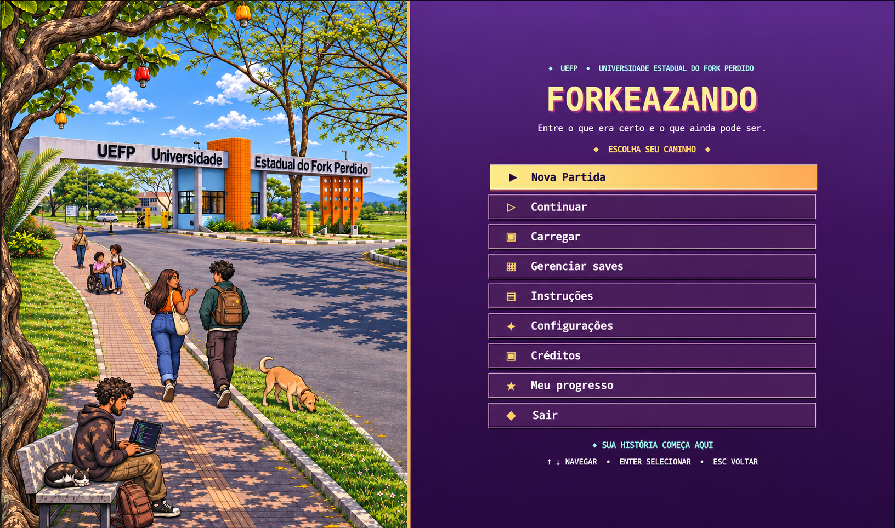
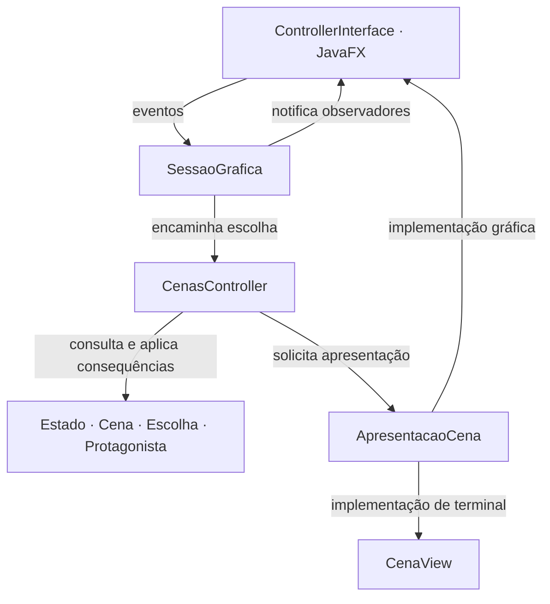

# Forkeazando

<p align="center">
  <strong>Entre o que era certo e o que ainda pode ser.</strong>
</p>

<p align="center">
  Uma visual novel sobre Engenharia de Computação, vida universitária e as consequências de tentar dar conta de tudo.
</p>

<p align="center">
  
  
  
  
  
  <a href="https://github.com/StheffannyNAlves/Forkeazando/tree/v1.5.0"></a>
  <a href="https://github.com/StheffannyNAlves/Forkeazando/actions/workflows/tests.yml"></a>
</p>



**Forkeazando** é um jogo narrativo interativo desenvolvido para **MI-Programação (EXA863)**, do curso de Engenharia de Computação da **Universidade Estadual de Feira de Santana — UEFS**, seguindo a metodologia **PBL — Problem-Based Learning**.

A história acontece na **Universidade Estadual do Fork Perdido — UEFP**, uma universidade fictícia inspirada no cotidiano universitário. O jogador acompanha **Tiana ou Miles**, do ingresso na graduação às primeiras decisões profissionais, construindo uma trajetória por meio de escolhas, atributos, vínculos e acontecimentos que reaparecem mais tarde.

O projeto começou no terminal, ganhou persistência e uma campanha mais extensa e chegou ao JavaFX sem abandonar o núcleo construído nas primeiras fases. Este README apresenta o jogo atual e registra essa evolução, incluindo as decisões de narrativa, arquitetura, apresentação e validação.

> **Status do projeto:** ✅ **Concluído — Fase 3 (v1.5.0).** O Forkeazando teve seu desenvolvimento acadêmico finalizado em **22/11/2026**, com a integração da interface JavaFX, evolução narrativa, persistência, padrões de projeto GoF e testes automatizados. Esta versão representa a entrega final da disciplina MI-Programação (EXA863). Melhorias futuras poderão ser realizadas, mas não fazem parte do escopo desta entrega.

**Acesso rápido:** [Executar](#como-executar) · [Conhecer a interface](#interface-arte-e-animações) · [Arquitetura e GoF](#arquitetura-e-padrões) · [Testes](#testes-e-validação) · [Histórico de versões](#versões)

## Navegação

- [O jogo e sua proposta](#o-jogo-e-sua-proposta)
- [Como executar](#como-executar)
- [Protagonistas e criação de personagem](#protagonistas-e-criação-de-personagem)
- [Sistemas de jogo](#sistemas-de-jogo)
- [Personagens e relações](#personagens-e-relações)
- [Organização da narrativa](#organização-da-narrativa)
- [Conquistas, colecionáveis e finais](#conquistas-colecionáveis-e-finais)
- [Salvamentos e configurações](#salvamentos-e-configurações)
- [Interface, arte e animações](#interface-arte-e-animações)
- [Evolução desde a Fase 1](#evolução-desde-a-fase-1)
- [Decisões de projeto](#decisões-de-projeto)
- [Arquitetura e padrões](#arquitetura-e-padrões)
- [Tecnologias e estrutura](#tecnologias-e-estrutura)
- [Roteiro em JSON e manutenção](#roteiro-em-json-e-manutenção)
- [Testes e validação](#testes-e-validação)
- [Estado da entrega e evoluções futuras](#estado-da-entrega-e-evoluções-futuras)
- [Versões](#versões)
- [Autoria, créditos e transparência](#autoria-créditos-e-transparência)

## O jogo e sua proposta

A universidade é mais que um fundo para os diálogos. Ela interfere no tempo disponível, nas possibilidades materiais e nas decisões: um horário de ônibus pode limitar uma matrícula; uma bolsa pode significar permanência; uma atividade interessante pode custar a energia necessária para terminar outra.

A experiência combina humor, sátira institucional e conflitos pessoais. Há filas do RU, editais, avaliações, reuniões, oficinas, projetos, relações com colegas e professores, cobranças, uma greve e os primeiros contatos com o trabalho profissional. O **Sistema Acadêmico**, também apresentado como **ÁGATA**, transforma respostas rápidas em classificações aparentemente precisas — e nem sempre úteis para quem precisa decidir.

O conflito recorrente é a distância entre **aprender**, **parecer competente** e **conseguir demonstrar o próprio trabalho**. Um LED que não acendeu, um resultado de experimento que não se repetiu ou uma prova que deu errado não desaparecem apenas porque a próxima cena começou.

### O que existe na versão atual

| Elemento | Situação na referência documentada |
|---|---|
| Protagonistas | Tiana e Miles, com nome personalizável e variações narrativas. |
| Campanha | Prólogo, oito capítulos, ramificações do capítulo 5 e evento de esgotamento. |
| Conteúdo cadastrado | **165 cenas e 462 alternativas**, somadas entre todos os caminhos. |
| Roteiro | **13 arquivos de cenas**, mais um arquivo específico de variações dos protagonistas. |
| Apresentação das cenas | **165 cenas com ambiente explicitamente mapeado**, distribuídas por **44 ambientes/variantes**. |
| Conquistas | **6** entradas no catálogo. |
| Colecionáveis | **15** entradas: **7 habilidades e 8 itens**. |
| Desfechos | **5 finais de carreira atuais**; 3 registros antigos mantidos para compatibilidade. |
| Persistência | 3 slots manuais, autosave, progresso permanente e preferências; exclusão de autosave com confirmação. |
| Interfaces | JavaFX na Fase 3; interface de terminal preservada. |

Esses números descrevem o conteúdo cadastrado, não uma única partida: caminhos alternativos, condições e cenas de apoio fazem com que o jogador não veja tudo em um percurso. Os 44 ambientes também são compartilhados entre cenas no mesmo lugar; não há 165 ilustrações diferentes.

## Como executar

### Requisitos

- **JDK 21**, com `java` e `javac` disponíveis.
- **Maven** instalado e configurado para usar esse JDK.
- Acesso à internet na primeira execução para baixar as dependências do Maven.
- Ambiente gráfico para a versão JavaFX; terminal interativo para a versão JLine.

O Maven resolve JavaFX, Gson, JLine e JUnit pelo `pom.xml`. Não é necessário instalar um SDK JavaFX separado para executar pelo plugin configurado no projeto. O Scene Builder é opcional e serve para editar FXML.

Confira o ambiente:

```bash
java -version
javac -version
mvn -version
```

Verifique especialmente o Java informado pelo **Maven**: ele também precisa ser o 21. A revisão de referência utilizou JDK **21.0.13** e Maven **3.9.9**.

### Interface gráfica — Fase 3

```bash
git clone --branch main --single-branch https://github.com/StheffannyNAlves/Forkeazando.git
cd Forkeazando
mvn javafx:run
```

Se já possui uma cópia desta versão, execute `mvn javafx:run` na pasta que contém o `pom.xml`.

O ponto de entrada gráfico é [`ForkeazandoApp`](src/main/java/br/uefs/forkeazando/view/javafx/ForkeazandoApp.java). A janela abre em **1280 × 760**, permite redimensionamento e define um mínimo de **960 × 620**. Telas e textos extensos usam rolagem.

### Interface de terminal

Em Linux ou outro ambiente com Bash:

```bash
chmod +x rodar.sh
./rodar.sh
```

O script compila o projeto, gera o classpath em `cp.txt` e inicia `br.uefs.forkeazando.Main`. Use um terminal real, preferencialmente com cores de 24 bits; o console de execução de uma IDE pode não fornecer os recursos necessários. A aplicação detecta um terminal do tipo `dumb` e informa essa limitação.

Para exibir apenas os quadros finais das animações do **terminal**:

```bash
FORKEAZANDO_SEM_ANIMACAO=1 ./rodar.sh
```

Essa variável é lida pelo animador de terminal; ela não constitui uma opção global para desativar os efeitos JavaFX.

### Compilar, testar e gerar o JAR

```bash
mvn clean test
mvn package
```

O Maven Shade produz `target/forkeazando.jar`. O manifesto desse JAR aponta para a **interface de terminal**:

```bash
java -jar target/forkeazando.jar
```

Para abrir a interface gráfica, continue usando `mvn javafx:run`. O JAR atual não é um instalador nem um pacote autossuficiente de distribuição JavaFX.

### Dificuldades comuns

| Sintoma | Verificação |
|---|---|
| Erro sobre versão de Java ou `release 21` | Confira `mvn -version`, `JAVA_HOME` e o JDK selecionado pela IDE. |
| O JAR abre o terminal | É o ponto de entrada definido no Shade. Use `mvn javafx:run` para a GUI. |
| Mensagem para usar um terminal real | Execute a versão JLine fora do console interno da IDE. |
| Testes gráficos pulados no Linux | Verifique a disponibilidade de `DISPLAY`; veja [Testes e validação](#testes-e-validação). |
| Os saves parecem ter desaparecido | Confira o diretório de trabalho: `saves/` é relativo à pasta de onde o processo foi iniciado. |
| Fonte ou proporções diferem das capturas | O CSS usa fontes do sistema, incluindo DejaVu; disponibilidade de fontes e escala do sistema podem alterar o resultado. |
| A música não toca | A reprodução depende de uma saída de áudio compatível com Java Sound. A falta dela não comprova falha da navegação. |

Para investigar a renderização gráfica em uma máquina sem aceleração disponível, uma alternativa de diagnóstico é o Prism por software:

```bash
JAVA_TOOL_OPTIONS="-Dprism.order=sw" mvn javafx:run
```

Esse modo foi usado na inspeção da interface; não equivale a uma medição de desempenho em todos os computadores.

## Protagonistas e criação de personagem

### Tiana e Miles

Os nomes apresentados ao jogador são **Tiana** e **Miles**. A escolha da identidade e o nome personalizado são informações distintas: renomear o personagem não transforma sua identidade nem apaga sua trajetória.

O protagonista não selecionado pode aparecer no roteiro como colega. O arquivo [`variacoes_protagonistas.json`](src/main/resources/roteiro/variacoes_protagonistas.json) permite variar essas participações sem duplicar toda a campanha. A estrutura principal é compartilhada, mas reações, referências e algumas condições dependem das identidades e das escolhas.

A caracterização inicial funciona como ponto de partida. O jogador continua podendo construir outra forma de lidar com os acontecimentos ao longo da graduação.

### Origem e perfil

A criação considera:

| Escolha inicial | Representação no jogo |
|---|---|
| Situação econômica | Apertada, estável, confortável ou elite; participa do cálculo da energia máxima inicial. |
| Experiência emocional no ensino médio | Negativa, neutra ou positiva; influencia confiança, sanidade e energia inicial. |
| Vida social | Isolado, equilibrado ou amigueiro; define o ponto inicial da vida social. |
| Perfeccionismo | Registra uma característica de perfil e sua flag de origem. |
| Sociabilidade | Influencia carisma e registra uma característica de perfil. |
| Preferência de estudo | Perfil teórico ou prático; influencia lógica e referências narrativas. |

As condições de origem representam diferenças de recursos e experiências. Elas não são uma seleção de dificuldade declarada nem determinam sozinhas qual final será alcançado.

<details>
<summary><strong>Nota técnica: por que ainda aparecem nomes antigos no código?</strong></summary>

O enum `IdentidadeProtagonista` conserva `STHEFFANNY` e `DAVI`; flags como `protagonista_stheffanny` e `protagonista_masculino`, além de caminhos antigos de recursos, também continuam presentes. São identificadores de compatibilidade do projeto, e não os nomes padrão exibidos ao jogador.

A mudança de apresentação para Tiana/Miles foi separada da identidade persistida para evitar renomeações em cascata de flags, saves e referências do roteiro. Uma futura migração desses identificadores precisa tratar os dados antigos explicitamente.

</details>

## Sistemas de jogo

### Atributos, recursos e estado

| Sistema | Faixa ou representação | Consequência na jornada |
|---|---|---|
| Energia | De 0 à energia máxima individual | Limita compromissos e participa do evento de esgotamento. |
| Score | 0–100 | Registra desempenho acumulado e participa de requisitos. |
| Participação | 0–100 | Representa envolvimento e pode habilitar ou restringir alternativas. |
| Confiança | 0–10 | Interfere em condições e reações. |
| Vida social | 0–10 | Participa de condições de convivência e apoio. |
| Carisma | 0–10 | Participa de alternativas que dependem de interação. |
| Lógica | 0–10 | Participa de condições e de resultados acadêmicos. |
| Sanidade | 0–10 | Recurso narrativo associado ao desgaste e às condições do personagem. |
| Relacionamentos | Pontuação por código de personagem | Traduz vínculos em aliado, colega ou rival. |
| Flags | Marcadores únicos de origem, eventos e decisões | Mantêm consequências entre cenas, capítulos e salvamentos. |

O rank apresentado na interface deriva do score: **Calouro Perdido**, **Estagiário do Caos**, **Sobrevivente do 1º Semestre**, **Veterano Casca Grossa** e **Lenda do Campus**. Esse rótulo não substitui as demais dimensões da trajetória.

### Escolhas condicionais

Uma alternativa pode exigir score, participação, atributos, flags, energia ou níveis de relacionamento. O domínio determina quais escolhas estão disponíveis; a interface apresenta o resultado dessa avaliação.

Ao confirmar uma escolha, o jogo pode:

- Aplicar custos de energia e ganhos ou perdas de atributos.
- Alterar relações e informar seu impacto.
- Conceder flags, itens e habilidades.
- Registrar uma trilha, reprovação, trancamento ou outro marco.
- Apresentar `textoConsequencia` antes de continuar.
- Encaminhar a próxima cena ou acionar uma resolução específica do roteiro.

Algumas passagens permitem prosseguir mesmo sem energia suficiente, conforme sua configuração narrativa. O significado de cada custo e requisito pertence às regras do jogo; um efeito de hover, retrato ou transição não deve alterar esse estado.

### Esgotamento, tempo e retomada

O esgotamento é um evento de jogo, com cenas próprias **970–972**, que pode interromper o caminho em andamento. Relações e vida social influenciam a forma como o episódio acontece e o apoio percebido. Depois, o fluxo retoma a jornada.

Esse evento não é idêntico ao arco de crise do capítulo 6. A campanha também registra situações como reprovação, ajustes de percurso e trancamento, com reflexos no calendário e nas referências aos semestres seguintes. O jogo não pressupõe que todas as pessoas concluam a trajetória no mesmo ritmo.

### Avaliações, currículo e memória da trajetória

O resultado da primeira prova considera o percurso registrado, inclusive preparação, estratégias e diferentes formas de entrega. O número mostrado no mural não é uma nota fixa desenhada na ilustração: a apresentação narrativa utiliza o resultado calculado pelo sistema.

O currículo e os epílogos reúnem evidências do que foi feito: formação, experiências, projetos, habilidades, integridade e lacunas. Uma nota alta, uma atividade remunerada ou uma boa aparência no portfólio não apagam automaticamente as decisões que produziram esses resultados.

## Personagens e relações

| Personagem | Papel na experiência |
|---|---|
| **Caio Andrade** | Veterano que acompanha escolhas e limites, com uma trajetória própria por trás dos conselhos. |
| **Dandara Oliveira** | Colega presente nos estudos, na permanência e nas disputas por oportunidades. |
| **Beatriz Menezes — Bia** | Colega ligada a resumos, avaliações, pesquisa e apoio; sua participação ultrapassa uma única função no conflito. |
| **Prof. Dr. Sérgio Viana** | Referência da iniciação científica, dos experimentos, prazos e discussões sobre autoria. |
| **Prof. Rafael Meira** | Ligado ao ensino, às avaliações e à monitoria de DTEC. |
| **Zé do Módulo 8** | Parte da convivência universitária e de contatos que chegam fora das estruturas formais. |
| **Alan e Malu** | Colegas que acompanham a rotina, os projetos e a leitura bem-humorada do campus. |
| **Sistema Acadêmico / ÁGATA** | Representa classificações, recomendações e contradições institucionais. |
| **Caramelo** | Presença recorrente no campus e em acontecimentos da jornada. |

O roteiro também inclui participações contextuais, como **Noa** e **Téo**, e o protagonista que não foi escolhido. Nem toda pessoa citada possui um relacionamento numérico ou uma entrada própria no registro de personagens.

Os vínculos registrados pelo modelo são categorizados assim: **aliado** a partir de 3 pontos, **rival** até −3 e **colega** entre esses limites. Interesses dos personagens podem modificar a intensidade de certos impactos.

## Organização da narrativa

A abertura começa no futuro, com uma entrevista e uma fotografia de um projeto que não funcionou na demonstração. A história então retorna ao ingresso universitário. A retomada desse enquadramento no fim conecta o portfólio ao trabalho real que o jogador construiu.

O campus é fictício, mas procedimentos e conflitos foram revistos com atenção à experiência universitária que inspira o jogo. Na matrícula, por exemplo, o roteiro considera a documentação e os procedimentos de ingresso, em vez de tratar tudo como uma fila presencial genérica. O processo de referência do ingresso 24.2 está no [portal de matrícula da CSA/UEFS](https://csa.uefs.br/index.php/sisu241/inicial); as regras do jogo são uma adaptação narrativa, não um guia atual de matrícula.

### Capítulos e conteúdo cadastrado

| Parte | Eixo narrativo | Arquivo | Cenas | Alternativas |
|---|---|---|---:|---:|
| Prólogo | Entrevista, memória e expectativas de ingresso | [abertura.json](src/main/resources/roteiro/abertura.json) | 4 | 7 |
| Capítulo 1 — Matrícula | Documentação, campus, RU, oficina e primeiros vínculos | [capitulo1.json](src/main/resources/roteiro/capitulo1.json) | 17 | 54 |
| Capítulo 2 — As Primeiras Sereias | Grupos, extensão, seleções e excesso de compromissos | [capitulo2.json](src/main/resources/roteiro/capitulo2.json) | 22 | 59 |
| Capítulo 3 — A Primeira Prova Real | Preparação, avaliação, integridade e recuperação | [capitulo3.json](src/main/resources/roteiro/capitulo3.json) | 20 | 55 |
| Capítulo 4 — A Bifurcação | Matrícula, pré-requisitos, editais e definição de trilha | [capitulo4.json](src/main/resources/roteiro/capitulo4.json) | 24 | 56 |
| Capítulo 5 — A Greve | Calendário, permanência e consequências compartilhadas | [capitulo5.json](src/main/resources/roteiro/capitulo5.json) | 3 | 15 |
| Ramificação 5A — IC | Experimentos, trabalho de pesquisa e bolsa | [capitulo5a.json](src/main/resources/roteiro/capitulo5a.json) | 11 | 31 |
| Ramificação 5B — DTEC | Monitoria, condições de ensino e responsabilidade | [capitulo5b.json](src/main/resources/roteiro/capitulo5b.json) | 5 | 12 |
| Ramificação 5C — Independente | Escopo, entrega, pagamento e negociação | [capitulo5c.json](src/main/resources/roteiro/capitulo5c.json) | 6 | 17 |
| Capítulo 6 — A Crise | Desgaste, apoio, limites e reorganização | [capitulo6.json](src/main/resources/roteiro/capitulo6.json) | 25 | 68 |
| Capítulo 7 — A Última Prova | TCC e dilemas técnicos e éticos de cada trilha | [capitulo7.json](src/main/resources/roteiro/capitulo7.json) | 9 | 33 |
| Capítulo 8 | Formatura, entrevista, inserção e desfechos | [capitulo8.json](src/main/resources/roteiro/capitulo8.json) | 16 | 48 |
| Evento de esgotamento | Interrupção e retomada do percurso | [apagao.json](src/main/resources/roteiro/apagao.json) | 3 | 7 |
| **Total** | **Todos os caminhos e eventos cadastrados** | **13 arquivos de cenas** | **165** | **462** |

As ramificações 5A, 5B e 5C fazem parte do capítulo 5; não são três capítulos adicionais de uma campanha linear. O arquivo de greve também participa do fluxo compartilhado. A ordem em que esses arquivos aparecem na pasta não define a ordem da partida: o carregador considera `ordemGlobal`, e o roteamento decide o percurso.

### Trilhas e finais são decisões diferentes

**IC, DTEC e Independente** representam caminhos vividos durante a graduação. Os **finais de carreira** atuais são resolvidos mais adiante, considerando evidências acumuladas, vínculos e escolhas.

O jogador não recebe simplesmente um menu com cinco profissões na última tela. `ResolucaoDeFuturo` avalia o histórico e registra o caminho correspondente. A rota independente assumida anteriormente possui uma regra própria; cair nela por perder um prazo não deve, por si só, obrigar uma carreira independente no epílogo.

<details>
<summary><strong>Ver os desfechos e conquistas atuais — contém spoilers</strong></summary>

Os cinco finais de carreira são:

| Registro | Título |
|---|---|
| `PESQUISA_BRASIL` | Pesquisa no Brasil |
| `TECNOLOGIA` | Tecnologia aplicada |
| `INTERNACIONAL` | Além das fronteiras |
| `CAMINHO_PROPRIO` | Carreira independente |
| `TRANSICAO` | Recomeçar sem apagar o passado |

Os registros antigos **A Cientista**, **Mão na Massa** e **O Contato** continuam reconhecidos em dados legados. Eles não significam três novos finais de carreira adicionados à campanha atual.

As conquistas do catálogo são **Primeiro Passo**, **Do Meu Lado**, **Ainda Aqui**, **Cabe Mais Um**, **Sem Ensaiar** e **Ninguém Faz Isso Só**. Seus critérios estão em [`Conquista.java`](src/main/java/br/uefs/forkeazando/model/Conquista.java).

Os epílogos retomam experiências e relações. O encerramento preserva a fotografia da primeira bancada com o **LED apagado**: a arte não deve inventar um sucesso que a memória da cena não registra.

</details>

## Conquistas, colecionáveis e finais

Há uma separação entre **estado da partida** e **progresso permanente**:

- A partida guarda o personagem, sua cena, atributos, relações e decisões daquele percurso.
- O progresso reúne conteúdos conhecidos, conquistas, datas de desbloqueio e finais registrados entre jornadas.

O menu **Meu progresso** consulta **finais** e **conquistas**. Durante a partida, a **Galeria** reúne **habilidades, itens e conquistas**, enquanto a tela **Status** apresenta atributos, inventário, relacionamentos, objetivo contextualizado e marcos da trajetória em linguagem legível. O progresso global e o estado da partida são armazenados separadamente.

O catálogo inclui habilidades como **Olho de Edital**, **Foco Total** e **Palavra Honesta**, além de itens como **Cartão do RU**, **Copo térmico do Caio** e **Contato da Bia**. A representação visual de conteúdo bloqueado não concede esse conteúdo à partida.

Recomeçar uma jornada e carregar outro slot são operações distintas de apagar o arquivo de progresso permanente. Para preservar todos os registros em um backup, copie a pasta `saves/` inteira.

## Salvamentos e configurações

### Arquivos utilizados

Os dados são locais, em JSON, e ficam em uma pasta `saves/` relativa ao diretório de trabalho do processo:

| Arquivo | Conteúdo |
|---|---|
| `saves/slot1.json` | Primeiro slot manual. |
| `saves/slot2.json` | Segundo slot manual. |
| `saves/slot3.json` | Terceiro slot manual. |
| `saves/autosave.json` | Registro automático mais recente. |
| `saves/progresso.json` | Conquistas, conteúdos descobertos e finais. |
| `saves/configuracao.json` | Preferências de texto, áudio, dicas e confirmação. |

### Fluxo na interface gráfica

- **Continuar** retoma a sessão que ainda está em memória.
- **Carregar** oferece slots e autosave; não é sinônimo de continuar uma sessão em memória.
- **Salvar** e **Gerenciar saves** permitem escolher um dos três slots manuais.
- Slots ocupados exigem confirmação de sobrescrita; a exclusão também possui confirmação.
- **Excluir autosave** aparece em **Gerenciar saves** quando existe um salvamento automático, exige confirmação e não exclui os três slots manuais nem a partida atual em memória. Cancelar a confirmação preserva o arquivo.
- A listagem distingue slots vazios, ocupados ou inválidos e apresenta metadados disponíveis.
- O salvamento manual pede a escolha do slot; a interface não presume que deve sobrescrever automaticamente o slot que foi carregado.

O gatilho periódico do autosave ocorre a cada **cinco cenas concluídas**. A conclusão da jornada também é persistida em autosave. Há somente um `autosave.json`, substituído por registros posteriores.

O autosave **não marca o estado como salvo manualmente**. Por isso, o jogo ainda pode oferecer salvamento ao sair mesmo depois de uma notificação de autosave. Voltar ao menu mantém a sessão em memória; encerrar o processo exige um arquivo salvo para retomá-la depois.

### Proteção da sessão e exclusão do autosave

Os fluxos gráficos de **carregar** e **criar outra partida** preparam o controlador candidato antes de substituir o estado atual da sessão. Quando a leitura do progresso ou a criação desse controlador falha, a partida anterior e seu controlador permanecem disponíveis; a interface apresenta o erro. A confirmação de nova partida avisa sobre alterações não salvas. Essa proteção cobre a **preparação da sessão**, não promete rollback de toda exceção posterior de renderização.

A opção **Excluir autosave** passa por `GerenciamentoPartidas` → `CarregamentoAdapter` → `GerenciadorSlots.excluirAutosave`. A exclusão não exige desserializar o JSON, inclusive se o arquivo estiver corrompido. Se o arquivo estiver ausente, o serviço sinaliza `SaveException`. Excluir não desativa o gatilho: um novo autosave poderá surgir depois de mais cenas concluídas ou ao finalizar a jornada.

### Integridade e compatibilidade

`GerenciadorSave` utiliza Gson, valida estrutura e dados e reconhece tanto o formato antigo sem envelope quanto o formato atual com `versao`, `dataSalvamento` e `estado`. A versão atual do envelope de save é **1**.

`ArquivoAtomico` escreve primeiro em um arquivo temporário e tenta substituí-lo com movimento atômico; quando o sistema de arquivos não oferece esse recurso, usa uma substituição convencional. Exceções específicas distinguem problemas de leitura, gravação e dados inválidos.

Existem tratamentos de compatibilidade para identidades, trilhas, resultados e finais antigos. Isso não garante que qualquer save arbitrário de qualquer revisão narrativa possa ser retomado: IDs removidos, mudanças de percurso e estados incompatíveis precisam ser avaliados. Preserve uma cópia dos saves antes de trocar entre versões do roteiro.

**Três versões diferentes não devem ser confundidas:** o `pom.xml` informa `1.5.0` (versão do artefato); os arquivos atuais de cenas usam esquema JSON `3`; e o envelope de salvamento usa `versao: 1`.

### Preferências persistentes

| Opção | Valores |
|---|---|
| Velocidade do texto | Lenta, normal ou rápida. |
| Volume da música | 0–100. |
| Confirmação de saída | Confirmação adicional mesmo sem alterações pendentes. |
| Dicas de teclado | Exibir ou ocultar as dicas disponíveis. |

As preferências são gravadas por `ConfiguracoesAdmin`. Na inicialização, configurações inválidas possuem tratamento de recuperação para valores padrão. A velocidade configurada controla o texto progressivo; o jogador também pode completá-lo imediatamente.

## Interface, arte e animações

### Direção visual

A interface conserva a identidade do Forkeazando: **roxo, dourado, coral e menta**, contornos marcados, cantos retos e referências a menus de RPG e pixel art. A hierarquia separa capítulo, personagem, HUD, fala e decisões.

O menu combina a ilustração do campus com uma coluna de navegação. Nas cenas, cenário e retrato ficam ao lado do texto; as escolhas aparecem abaixo, com espaço para leitura e rolagem. Modais e telas secundárias mantêm a mesma linguagem visual.


*Capturas reais da aplicação JavaFX durante a inspeção do refinamento visual, em 1280 × 760. A imagem de cena ilustra uma leitura longa; as alternativas continuam abaixo, na área com rolagem. São registros pontuais da interface, não uma demonstração de campanha completa.*

### Controles JavaFX

| Contexto | Ação |
|---|---|
| Menu principal | `↑` e `↓` selecionam; `Enter` ativa a opção selecionada; mouse também disponível. |
| Durante a digitação | Clique no texto, botão **Mostrar texto**, `Espaço` ou `Enter` completam a fala. |
| Escolhas de cena | Clique no botão da alternativa disponível. |
| Painéis extensos | Rolagem pelo mouse ou pelos controles da barra de rolagem. |
| Tela secundária | `Esc` volta ao menu e mantém a partida em memória. |
| Modal informativo | `Enter` ou `Esc` fecham o modal apresentado. |
| Encerrar a janela | Passa pelo fluxo de saída, considerando preferências e alterações pendentes. |

Completar uma fala não é confirmar uma decisão. Durante a revelação, o primeiro `Espaço`/`Enter` é consumido para terminar o texto. As confirmações de sobrescrita, exclusão e saída utilizam seus próprios botões e painéis.

### Diálogos

`DialogoFx` reserva o espaço da fala inteira antes da digitação. Isso evita que as escolhas e a rolagem mudem continuamente de posição enquanto aparecem novas linhas.

O efeito possui três velocidades, pausas associadas à pontuação e segmentação de caracteres com `BreakIterator`. Ao sair da tela, a digitação é concluída/interrompida pelo ciclo de apresentação, sem continuar escrevendo em um painel abandonado.

### Personagens

O acervo combina retratos PNG, expressões, quadros de idle, transições existentes e retratos procedurais de compatibilidade. A expressão solicitada pela cena prevalece sobre um efeito genérico.

Na expressão neutra, as piscadas usam intervalos variados e os quadros já disponíveis. Nas demais expressões, movimentos discretos de respiração preservam o rosto adequado à emoção. Expressões específicas sem PNG correspondente usam o fallback em pixel art, em vez de serem substituídas silenciosamente por um rosto neutro.

As pastas de recursos incluem retratos de personagens adicionais; a existência de um sprite não significa que ele já tenha uma rota própria ou um relacionamento implementado.

### Cenários e momentos especiais

Todos os ambientes possuem uma **entrada finita** e um **repouso animado independente**. Ao continuar uma conversa no mesmo ambiente, a apresentação pode partir do quadro final e manter o movimento ambiental, sem repetir um acontecimento inteiro.

Os efeitos ambientais são locais: chuva, vapor, luzes, folhas, estrelas, cursores e sinais de bancada, conforme o lugar. O movimento não precisa competir com a leitura. Os 44 ambientes/variantes incluem secretaria, extensão em escola, auditório, ponto de ônibus, comemoração em casa, corredor de apoio e a fotografia final.

O refinamento também completou ações que antes paravam pela metade: a escrita de **UEFP** no vidro do ônibus, o arco dos gorros na formatura, a saída do avião e o estado final do processamento do ÁGATA. As perguntas do sistema e seu resultado possuem apresentação adequada a cada momento.

Aprovação, mudanças de capítulo, conquistas e epílogos recebem destaque de apresentação. A arte preserva o que aconteceu na narrativa: um placar não inventa a nota do jogador e a lembrança de um LED apagado não vira uma demonstração bem-sucedida por conveniência visual.

### Fluidez e gerenciamento de recursos

| Componente | Responsabilidade |
|---|---|
| `AnimacoesFx` | Registra efeitos por nó e canal, substitui concorrentes e controla pausa, retomada e encerramento. |
| `ArtesFx` | Carrega retratos, prepara cenários, mantém caches limitados e administra a apresentação das imagens. |
| `DialogoFx` | Organiza a fala e o seu comportamento de leitura. |
| `AvisosFx` | Serializa notificações e evita que avisos de rotina se empilhem sobre a narrativa. |
| `RasterizadorCenario` | Converte pixels e rótulos de `Tela` para a imagem utilizada pelo JavaFX. |
| `GerenciadorAudio` | Prepara e controla a trilha em um executor dedicado. |

O desenho dos cenários é preparado fora da JavaFX Application Thread, e a imagem é aplicada na interface pelo mecanismo do JavaFX. A preparação de áudio também possui fila própria. Isso não significa que toda operação de I/O do projeto seja assíncrona: a persistência local ainda inclui chamadas síncronas.

As imagens procedurais usam ampliação inteira, com pixels de origem de **66 × 48** convertidos para **396 × 288**, sem suavização da pixel art. A conversão também preserva a camada textual de placas e monitores. O texto da interface permanece em pixels lógicos de layout, sem uma escala fracionária global aplicada à janela inteira.

Os caches são limitados, os efeitos são cancelados ao remover os nós e as animações podem ser pausadas em modais ou ao minimizar a janela. Preparações assíncronas também consideram a anexação tardia à cena para não perder uma imagem pronta antes de o nó entrar na árvore.

### Terminal preservado


*Demonstração histórica da Fase 2. O GIF permanece como registro da evolução; a interface gráfica atual é apresentada nas capturas acima.*

A versão de terminal utiliza JLine, cores de 24 bits, HUD, retratos, galeria e pixel art produzida pelo próprio código. O animador evita redesenhar linhas que não mudaram e pode mostrar apenas o quadro final.

| Tecla | Ação no terminal |
|---|---|
| `↑` / `↓` | Navegar pelas opções. |
| `←` / `→` | Alterar valores nos menus que oferecem ajustes. |
| `Enter` | Confirmar. |
| `P` | Pausar durante a narrativa, quando a pausa está habilitada. |
| `C` | Continuar após a pausa. |
| `Esc` | Cancelar/voltar nos menus que aceitam cancelamento. |

Salvar, abrir galeria e voltar ao menu também aparecem entre as opções disponíveis durante a partida no terminal. Esses controles não devem ser transferidos automaticamente para a GUI: as duas apresentações têm fluxos de entrada próprios.

## Evolução desde a Fase 1

### Fase 1 — Construir o núcleo antes de expandir

A primeira fase estabeleceu um jogo de terminal com menu, criação de personagem, um recorte do capítulo 1 e ramificações. O objetivo inicial já era relacionar a vida acadêmica às possibilidades profissionais, mas a entrega daquela etapa era menor que a campanha atual.

O núcleo incluía `Protagonista`, `Estado`, `Cena`, `Escolha` e personagens secundários, com energia, score, participação, condições de acesso, flags e reputação. O **Builder de escolhas** já aparecia nessa construção. O fluxo seguia a separação entre menu/controladores, domínio e apresentação no terminal.

As cenas eram construídas em Java, em `Capitulo1.criarCenas()`. O registro da Fase 1 mencionava **21 testes de unidade** e caminhos com encerramentos próprios. Save/load ainda não fazia parte daquela base; a capacidade de retomar uma jornada seria uma evolução posterior.

O README original dessa etapa está preservado no histórico em [`v1.0.0/docs/README.md`](https://github.com/StheffannyNAlves/Forkeazando/blob/v1.0.0/docs/README.md). Seus diagramas e contagens descrevem a entrega de então, e não a arquitetura ou o conteúdo atuais.

### Fase 2 — Transformar o protótipo em uma jornada persistente

A Fase 2 ampliou a campanha para prólogo, capítulos e trilhas, acrescentando sistemas para manter uma experiência mais longa:

- Persistência de partida em JSON, validação e tratamento de exceções.
- Progresso permanente, conquistas, habilidades, itens e histórico de finais.
- Galeria, HUD, retratos, ilustrações e animações em pixel art no terminal.
- Evento de esgotamento e consequências ligadas aos vínculos construídos.
- Três slots manuais, autosave, exclusão de arquivos e preferências persistentes.
- Trilha sonora, currículo, epílogos e transições entre capítulos.
- Migração do roteiro escrito em classes Java para recursos JSON.
- Extração de regras específicas, como sistema acadêmico, resultados e resolução de futuros.

Essa etapa também trouxe correções de persistência e de fluxo. Um caso registrado foi o tratamento inconsistente de **custos negativos de energia**: disponibilidade e consumo não interpretavam o mesmo dado da mesma forma. A correção de 03/11/2026 unificou o tratamento usado no consumo, sem transformar um custo de atividade em recuperação implícita. Ganhos de energia continuam representados pelas operações apropriadas do domínio.

As versões `v1.1.0` a `v1.4.0` documentam esses incrementos. A demonstração do terminal permanece no repositório porque essa interface contém parte importante da história técnica e visual do projeto.

### Fase 3 — Migrar para JavaFX preservando as regras

A Fase 3 adotou JavaFX, FXML e CSS, com menu ilustrado, criação de personagem, cenas e telas de apoio. A migração exigiu mudar o modo de conduzir a partida: um laço de terminal que espera entrada não pode comandar a JavaFX Application Thread.

O trabalho passou pela extração de operações do fluxo, aplicação do contrato `ApresentacaoCena`, integração de `SessaoGrafica` e reutilização de `CenasController`. As escolhas da GUI passaram a acionar o núcleo por eventos, em vez de manter uma segunda implementação de consequências.

Depois vieram Adapter para carregar e gerenciar saves, Observer para atualizar a interface, conclusão persistida, configurações, galeria, conquistas, status, narrativas dinâmicas e finais. Em paralelo, o roteiro foi revisto e passou a usar o esquema de cenas v3, com consequências textuais e variações de protagonistas.

O acabamento visual ampliou essa migração: legibilidade, janela redimensionável, texto progressivo, notificações discretas, controle do ciclo de animações e preparação de áudio e imagens. A revisão completou o mapeamento dos cenários e separou a entrada dos ambientes de seus movimentos de repouso. Em seguida, os fluxos de sessão ganharam preparação segura antes da substituição, o status passou a traduzir objetivos e decisões para o jogador e a tela de gerenciamento ganhou exclusão confirmada do autosave.

### Marcos verificáveis no histórico

| Período | Marco | Referência |
|---|---|---|
| Setembro de 2026 | Base de terminal, modelo, criação e ramificações da Fase 1 | [`v1.0.0`](https://github.com/StheffannyNAlves/Forkeazando/tree/v1.0.0) |
| Outubro de 2026 | Persistência, progresso, pixel art, roteiro JSON e consolidação do terminal | [`v1.1.0`](https://github.com/StheffannyNAlves/Forkeazando/tree/v1.1.0) a [`v1.4.0`](https://github.com/StheffannyNAlves/Forkeazando/tree/v1.4.0) |
| 09/11/2026 | Interface JavaFX inicial | [`878484b`](https://github.com/StheffannyNAlves/Forkeazando/commit/878484b) |
| 19–20/11/2026 | Contrato de apresentação, fluxo compartilhado e remoção de lógica duplicada da sessão gráfica | [`7152743`](https://github.com/StheffannyNAlves/Forkeazando/commit/7152743) e [`40295aa`](https://github.com/StheffannyNAlves/Forkeazando/commit/40295aa) |
| 21/11/2026 | Gerenciamento manual de saves e Observer no JavaFX | [`b0edde9`](https://github.com/StheffannyNAlves/Forkeazando/commit/b0edde9) e [`b4b1f24`](https://github.com/StheffannyNAlves/Forkeazando/commit/b4b1f24) |
| 22/11/2026 | Preparação de áudio fora da interface e refinamento de diálogos e animações | [`637ed3c`](https://github.com/StheffannyNAlves/Forkeazando/commit/637ed3c) e [`a298ba8`](https://github.com/StheffannyNAlves/Forkeazando/commit/a298ba8) |
| 22/11/2026 | Testes gráficos e conclusão das animações ambientais | [`8f86006`](https://github.com/StheffannyNAlves/Forkeazando/commit/8f86006) e [`e54d6fb`](https://github.com/StheffannyNAlves/Forkeazando/commit/e54d6fb) |

### Ajustes de robustez e apresentação em 22/11/2026

- **Status narrativo:** `StatusNarrativo` transforma marcos conhecidos em descrições legíveis e define objetivos contextualizados por capítulo, sem alterar flags ou regras.
- **Carregamento seguro:** `SessaoGrafica.carregarPartida(Estado, ApresentacaoCena)` prepara o controlador antes da troca da partida.
- **Nova partida segura:** `SessaoGrafica.novaPartida(Protagonista, ApresentacaoCena)` segue a mesma ordem de preparação e substituição; a tela entrega um `DadosProtagonista`, validado antes de criar o modelo.
- **Continuar:** sem partida em memória, o menu retoma o último autosave (exceto o de uma jornada já concluída).
- **Persistência mais encapsulada:** as consultas de progresso das telas gráficas usam `SessaoGrafica.consultarProgresso()`.
- **Autosave gerenciável:** `GerenciamentoPartidas` e `CarregamentoAdapter` expõem a exclusão já implementada no DAO, com confirmação e feedback na interface.
- **Regressão automatizada:** testes específicos foram acrescentados para os fluxos seguros de sessão, apresentação do status e exclusão isolada do autosave.

Essas alterações não constituem uma nova tag de release: devem ser relacionadas aos respectivos commits quando publicadas no histórico da branch.

## Decisões de projeto

### Decisões narrativas

| Decisão | Motivo e efeito |
|---|---|
| Situar a história na UEFP | Permite trabalhar a experiência universitária por meio de ficção e sátira, mantendo a UEFS como contexto acadêmico do desenvolvimento. |
| Manter origem e passado na criação | O personagem chega à universidade com experiências e recursos diferentes; seu ponto inicial não é neutro. |
| Separar nome exibido de identidade | Permite personalização sem quebrar referências narrativas e dados persistidos. |
| Compartilhar a campanha entre Tiana e Miles | Evita duplicação de roteiro e permite variações contextuais por identidade. |
| Rever diálogos e passagens da Fase 2 | Busca continuidade, apresentação adequada dos personagens e conflitos com consequências além da cena imediata. |
| Mostrar consequências após uma escolha | `textoConsequencia` torna a reação imediata legível, antes de uma nova situação começar. |
| Vincular a nota ao percurso | Diferencia preparação, estratégias, entrega em branco e cópia, sem tratar qualquer resultado como prova absoluta de capacidade. |
| Considerar matrícula e pré-requisitos | A progressão acadêmica precisa respeitar o que ocorreu anteriormente; a montagem da grade ganha espaço a partir do segundo semestre. |
| Dar contradições aos personagens | Apoio, interesse em bolsa, medo de avaliação e decisões questionáveis podem coexistir no mesmo personagem. |
| Tratar o ÁGATA como uma classificação limitada | Uma recomendação automática faz parte do conflito; não substitui a decisão e a experiência do jogador. |
| Resolver o futuro pela trajetória | O desfecho deve refletir evidências acumuladas, em vez de depender apenas de um botão no encerramento. |
| Retomar a fotografia da bancada | Liga o começo ao final e preserva a ideia de registrar falhas, investigar e aprender. |

Essas decisões orientam o roteiro atual. A coerência de cada percurso ainda precisa ser avaliada jogando combinações reais de cenas e escolhas; integridade estrutural e boa escrita são verificações complementares.

### Decisões técnicas e visuais

| Decisão | Justificativa |
|---|---|
| Preservar MVC durante a migração | Permite mudar a apresentação sem reescrever regras, atributos e consequências. |
| Concentrar o processamento da escolha no núcleo existente | Evita divergência entre terminal e GUI para uma mesma alternativa. |
| Usar contratos de apresentação e persistência | Reduz a dependência de classes concretas nos pontos de integração. |
| Adotar eventos no JavaFX | Mantém a interface disponível enquanto o usuário lê e decide. |
| Extrair componentes de apresentação | Diálogo, artes, notificações, status e configurações possuem responsabilidades próprias, reduzindo o crescimento de `ControllerInterface`. |
| Manter o roteiro em JSON | Separa conteúdo narrativo de apresentação e facilita revisar textos e condições com validação. |
| Preservar IDs e flags quando possível | Evita mudanças desnecessárias no significado de saves e progresso. |
| Separar partida de progresso permanente | Uma nova jornada não precisa apagar as descobertas das anteriores. |
| Limitar caches e usar executores dedicados | Reduz repetição de preparo e controla o uso de recursos sem criar uma thread por efeito. |
| Controlar animações por nó e canal | Impede que efeitos concorrentes continuem alterando a mesma propriedade sem coordenação. |
| Separar entrada de ambiente em repouso | Mantém o cenário vivo sem repetir uma ação narrativa a cada fala. |
| Conservar a pixel art com escala inteira | Preserva a leitura dos pixels e evita suavização desnecessária. |
| Usar rolagem e layout em pixels lógicos | Textos longos e janelas maiores não dependem de ampliar toda a interface como uma imagem. |
| Preferir notificações para eventos de rotina | Evita interromper repetidamente a leitura; erros e decisões continuam com apresentação apropriada. |

### Decisões recentes para preservar dados

| Decisão | Razão |
|---|---|
| Preparar a sessão candidata antes de substituí-la | Uma falha de leitura/validação do progresso não deve descartar a partida anterior. |
| Traduzir flags para textos de status | A interface não deve apresentar identificadores internos ao jogador nem duplicar regras do domínio. |
| Oferecer exclusão específica do autosave | O jogador gerencia o arquivo automático sem apagar slots manuais ou progresso global. |
| Centralizar consulta de progresso na sessão | Os componentes JavaFX deixam de instanciar diretamente o DAO nessas consultas. |

## Arquitetura e padrões

### MVC e fluxo da partida

O domínio representa personagens, estado, cenas e escolhas. Os controladores conduzem a progressão e coordenam regras e persistência. As views apresentam essas informações no terminal ou no JavaFX.

No JavaFX, `ControllerInterface` é um controlador de apresentação ligado ao FXML. `SessaoGrafica` mantém a sessão e encaminha ações para o controlador do jogo. A sessão fica no pacote `controller` e não deve se tornar uma cópia das regras de `CenasController`. As telas de criação do protagonista e de gerenciamento de saves foram extraídas para `TelaCriacaoFx` e `TelaSavesFx`, que só apresentam e coletam decisões; a validação dos dados do protagonista é feita por `DadosProtagonista` (Controller) e todo acesso a saves e preferências passa pela `SessaoGrafica`.



A interface [`ApresentacaoCena`](src/main/java/br/uefs/forkeazando/view/ApresentacaoCena.java) é o ponto de inversão de dependência: `CenasController` solicita operações como renderizar, mostrar consequências e apresentar epílogos sem precisar conhecer os detalhes de uma janela JavaFX ou de uma impressão no terminal.

A entrada de terminal continua tendo um laço que aguarda ações. Na GUI, callbacks de botões e teclado acionam operações de preparação e transição. Laços bloqueantes e `Thread.sleep` usados na experiência de terminal não são o mecanismo de animação da interface JavaFX.

### Três padrões GoF utilizados

| Categoria | Padrão | Implementação concreta | Problema resolvido |
|---|---|---|---|
| Criacional | **Builder** | `Escolha.Builder`, utilizado também pelo carregador JSON | Constrói escolhas com requisitos e efeitos opcionais sem um construtor extenso e ambíguo. |
| Estrutural | **Adapter** | `CarregamentoAdapter`, implementando `GerenciamentoPartidas` e `AcessoPartidas` | Traduz operações de carregar, listar, salvar e excluir para a infraestrutura de slots e saves já existente. |
| Comportamental | **Observer** | `ObservadorPartida`, lista de observadores em `SessaoGrafica` e `ControllerInterface.atualizar` | Propaga mudanças do estado para o HUD e a apresentação, inclusive alterações ocorridas na preparação de cenas. |

`GerenciamentoPartidas` estende o contrato de leitura com gravação e exclusão. A sessão recebe essa abstração para o gerenciamento de partidas. O Observer recebe o estado alterado; ele não é o responsável por aplicar a consequência narrativa.

**Participantes e evidências dos padrões:**

- **Builder — criacional:** `Escolha` é o produto; `Escolha.Builder` configura requisitos e efeitos opcionais e o método `build()` conclui a construção. `CarregadorRoteiroJson.converterEscolha()` é um cliente real do Builder. Assim, uma alternativa pode definir só os efeitos de que precisa, evitando construtores extensos e combinações ambíguas de parâmetros.
- **Adapter — estrutural:** `GerenciamentoPartidas` (que estende `AcessoPartidas`) é o contrato esperado pelos consumidores; `CarregamentoAdapter` o implementa e traduz as chamadas para `GerenciadorSlots` e `GerenciadorSave`. Inclui salvar, carregar, listar, excluir slots e excluir autosave. `SessaoGrafica` recebe `GerenciamentoPartidas`, em vez de depender das funções concretas de gravação de slots.
- **Observer — comportamental:** `SessaoGrafica` é o sujeito, registra objetos `ObservadorPartida` e os notifica depois de alterações relevantes; `ControllerInterface` implementa o contrato e atualiza o HUD em `atualizar(Estado)`. O domínio modifica os atributos; o observador apenas recebe a notificação e apresenta os valores. **Não se afirma que todas as atualizações da interface utilizam Observer**.

**Padrão de apoio — Strategy (comportamental):** `ApresentacaoCena` é a estratégia; `CenasController` é o contexto, que recebe a apresentação no construtor e delega a ela toda exibição; `CenaView` (terminal) e `ControllerInterface` (JavaFX) são as estratégias concretas. Resolve a necessidade concreta de rodar **o mesmo núcleo de regras** em duas interfaces sem duplicar consequências (`ApresentacaoCenaStrategyTest` executa o mesmo fluxo com duas implementações e compara o resultado). Os três padrões exigidos continuam sendo Builder, Adapter e Observer; o Strategy é um apoio para a justificativa caso o Adapter seja questionado.

MVC é a organização arquitetural, e DAO identifica a separação da persistência. **Memento** e **Factory** foram possibilidades discutidas durante a evolução; não são apresentados aqui como padrões adicionais formalmente implementados. A composição de nós do JavaFX, por si só, também não é contada como uma implementação autoral extra de GoF.

### SOLID na prática

O projeto usa os princípios como critérios para refatorações concretas:

- **Responsabilidade única:** extrair desenho, texto progressivo, áudio, avisos e painéis específicos evita concentrar cada detalhe visual em `ControllerInterface`.
- **Inversão de dependência:** `CenasController` depende de `ApresentacaoCena`; o acesso de gerenciamento da sessão utiliza um contrato e um Adapter.
- **Segregação de interfaces:** leitura de partidas e gerenciamento completo possuem contratos relacionados, sem obrigar um consumidor de leitura a declarar operações de escrita.
- **Extensão e substituição:** terminal e JavaFX oferecem implementações de apresentação para o mesmo fluxo central; novas implementações precisam preservar o comportamento esperado pelo contrato.

Isso não significa desacoplamento total: persistem coordenação de configurações na apresentação, alguns serviços estáticos e regras explícitas de roteamento. As consultas de progresso das telas **Meu progresso** e **Galeria** agora passam por `SessaoGrafica.consultarProgresso()`, mas o projeto ainda tem responsabilidades distribuídas que podem evoluir. O compromisso é evitar regras de consequências em componentes visuais e duplicação entre terminal e JavaFX.

## Tecnologias e estrutura

### Dependências e ferramentas

| Tecnologia | Versão/configuração no projeto | Uso |
|---|---|---|
| Java | Release 21 | Linguagem e plataforma de execução. |
| JavaFX | 21.0.13 | Controles, cenas, layout e animações da GUI. |
| FXML e CSS | Recursos JavaFX | Estrutura das telas e estilos. |
| Gson | 2.14.0 | Roteiro e dados persistidos em JSON. |
| JLine | 3.25.1 | Entrada interativa e terminal. |
| JUnit Jupiter | 5.11.0 | Testes automatizados. |
| Maven Compiler | 3.13.0 | Compilação com release 21. |
| Maven Surefire | 3.5.2 | Execução de testes. |
| Maven Shade | 3.6.0 | JAR com ponto de entrada de terminal. |
| JavaFX Maven Plugin | 0.0.8 | Execução gráfica com `mvn javafx:run`. |
| Java Sound | API do JDK | Reprodução da trilha em WAV. |
| Java 2D | API do JDK | Rasterização de rótulos de cenário, sem abrir janelas AWT. |
| Scene Builder | Opcional | Edição visual dos arquivos FXML. |

As versões declaradas estão em [`pom.xml`](pom.xml). O refinamento de animações utiliza os recursos do JDK/JavaFX e não adicionou uma biblioteca externa de animação.

### Pastas e responsabilidades

Os pacotes Java abaixo ficam em `src/main/java/br/uefs/forkeazando/`:

| Caminho | Responsabilidade e exemplos |
|---|---|
| [`model/`](src/main/java/br/uefs/forkeazando/model) | `Protagonista`, `Estado`, `Cena`, `Escolha`, `Progresso`, conquistas, finais e currículo. |
| [`controller/`](src/main/java/br/uefs/forkeazando/controller) | Fluxo do jogo, autosave, saves, configurações e progresso. |
| [`dao/`](src/main/java/br/uefs/forkeazando/dao) | Leitura, escrita, validação e organização dos arquivos locais. |
| [`adapter/`](src/main/java/br/uefs/forkeazando/adapter) | Contratos e adaptação do gerenciamento de partidas. |
| [`observer/`](src/main/java/br/uefs/forkeazando/observer) | Contrato de observação do estado. |
| [`roteiro/`](src/main/java/br/uefs/forkeazando/roteiro) | Carregamento, roteamento, narrativa dinâmica, resultados e metadados visuais. |
| [`view/`](src/main/java/br/uefs/forkeazando/view) | Contrato de apresentação e views de terminal. |
| [`view/javafx/`](src/main/java/br/uefs/forkeazando/view/javafx) | Aplicação gráfica, apresentação das telas e componentes visuais. |
| [`view/pixel/`](src/main/java/br/uefs/forkeazando/view/pixel) | Desenho procedural, retratos, cenários, quadros e animações de pixel art. |
| [`audio/`](src/main/java/br/uefs/forkeazando/audio) | Gerenciamento da trilha sonora. |
| [`excecao/`](src/main/java/br/uefs/forkeazando/excecao) | Exceções de domínio de carregamento, dados e persistência. |

| Outros caminhos | Conteúdo |
|---|---|
| [`src/main/resources/roteiro/`](src/main/resources/roteiro) | Documentos JSON de cenas e variações. |
| [`src/main/resources/fxml/`](src/main/resources/fxml) | `menuCompleto.fxml` e `telaSalvamento.fxml`. |
| [`src/main/resources/styles/`](src/main/resources/styles) | CSS; `menu-pixel.css` é a folha utilizada pela aplicação gráfica atual. |
| [`src/main/resources/images/`](src/main/resources/images) | Campus, retratos, expressões e sprites. |
| [`src/main/resources/audio/`](src/main/resources/audio) | Trilha sonora em WAV. |
| [`src/test/java/`](src/test/java) | Testes do domínio, fluxo, persistência, roteiro e apresentação. |
| [`docs/images/`](docs/images) | Capturas atuais e GIF histórico do terminal. |
| [`.github/workflows/tests.yml`](.github/workflows/tests.yml) | Integração contínua de testes com Java 21. |
| `saves/` | Dados locais criados em execução; não são conteúdo do roteiro. |
| `target/` | Saída de compilação, testes e empacotamento. |

`forkeazando.css` permanece no acervo de estilos; sua presença não significa que editar esse arquivo vá alterar a tela que atualmente carrega `menu-pixel.css`.

## Roteiro em JSON e manutenção

### Conteúdo, ordenação e validação

[`Roteiro`](src/main/java/br/uefs/forkeazando/roteiro/Roteiro.java) é a entrada pública para carregar as cenas. O carregador valida documentos e converte seus dados para o domínio, utilizando `Escolha.Builder`.

Os documentos atuais de cenas usam `schemaVersion: 3`. O carregador também reconhece a versão 2, enquanto a versão 3 exige `textoConsequencia`. O arquivo de variações possui esquema próprio, atualmente **1**, e não é um documento de cenas.

| Informação | Função |
|---|---|
| `schemaVersion` | Identifica o formato do documento. |
| `totalCenasArquivo` | Deve corresponder à quantidade de cenas declaradas. |
| `ordemGlobal` | Define ordenação global; pode ter lacunas para permitir inserções. |
| `id` | Identidade estável da cena, usada por rotas e salvamentos. |
| `capitulo` | Identificação narrativa da parte da campanha. |
| `personagemFalando` e `textoNarrativo` | Conteúdo da apresentação. |
| `escolhas` | Alternativas com destinos, requisitos e efeitos. |
| `textoConsequencia` | Retorno textual associado à decisão no esquema v3. |

Narrativas dinâmicas resolvem informações como nota, calendário e referências aos protagonistas. Por exemplo, `{{OUTRO_CENA}}` e `{{NOME_OUTRO_PROTAGONISTA}}` são processados para inserir a participação do colega correspondente à identidade escolhida.

### Alterar uma cena com segurança

1. Edite o documento em `src/main/resources/roteiro/`, preservando o esquema e os campos obrigatórios. Uma alternativa existente do mesmo formato serve como referência melhor que um JSON incompleto.
2. Confira o ID, a ordenação, os destinos, os requisitos e as flags produzidas e consumidas por outras cenas.
3. Se houver inserção de arquivo, inclua-o na lista explícita do carregador; apenas criar um JSON na pasta não o torna parte da campanha.
4. Para mudanças de regras ou resultados, utilize o domínio e os serviços de roteiro correspondentes. Não coloque a decisão em FXML, CSS ou em um efeito visual.
5. Atualize as variações de identidade quando necessário e confira se os marcadores dinâmicos continuam resolvidos.
6. Atualize `VisuaisDeCena` e o registro de ilustrações quando houver novos IDs ou ambientes.
7. Execute os testes pertinentes e percorra o trecho na interface. Mudanças de destino, trilha ou final exigem conferir também persistência e retomada.

### Alterar a apresentação

Use `menu-pixel.css` para os estilos atuais, `ArtesFx` para a integração das imagens e `AnimacoesFx` para a coordenação dos efeitos. Cenários procedurais são desenhados em `view.pixel`; `CenariosAmbiente` fornece os movimentos ambientais.

Ao adicionar uma animação, defina o que precisa terminar, o que pode continuar em repouso e quando o efeito deve ser interrompido. Se uma cena é carregada diretamente de um save, sua apresentação não pode depender de um cenário que talvez nunca tenha sido exibido naquela sessão.

## Testes e validação

### Execução automatizada

```bash
mvn clean test
```

Os relatórios ficam em `target/surefire-reports/`. A suíte possui testes para:

- Limites, requisitos, efeitos, flags e integridade do domínio.
- Processamento de escolhas, esgotamento, roteamento e autosave.
- Slots, formatos de save, dados inválidos, configurações, progresso e exclusão isolada do autosave.
- IDs, destinos, alcance e percursos do roteiro.
- Resultados acadêmicos, narrativas dinâmicas, currículo e finais.
- Construção de escolhas pelo Builder e aplicação de seus requisitos e efeitos.
- Desenho procedural, retratos, mapeamento de ambientes e estados finais das animações.
- Digitação, layout de falas longas, pausas, cancelamento de efeitos e apresentação assíncrona JavaFX.

Para selecionar um teste específico:

```bash
mvn -Dtest=VisuaisDeCenaTest test
mvn -Dtest=ApresentacaoFxTest test
```

No Linux, `ApresentacaoFxTest` verifica a disponibilidade de `DISPLAY` e pode ser pulado se não houver um display. Para executar também a parte gráfica em um ambiente com Xvfb e seu suporte instalados:

```bash
xvfb-run -a mvn clean test
```

O workflow de [GitHub Actions](.github/workflows/tests.yml) usa Java 21, instala Xvfb e executa `xvfb-run -a mvn -B clean test` em push, pull request e execução manual. Uma etapa adicional verifica o relatório de `ApresentacaoFxTest` para impedir que os testes gráficos sejam silenciosamente ignorados. O resultado de cada execução deve ser conferido na aba **Actions**.

### Regressões adicionadas após o refinamento visual

| Classe de teste | Comportamento exercitado |
|---|---|
| `StatusNarrativoTest` | Objetivos e marcos legíveis sem alterar o estado da partida. |
| `SessaoGraficaCarregamentoTest` | Preservação da sessão anterior diante de falha na preparação de um carregamento. |
| `SessaoGraficaNovaPartidaTest` | Preparação segura da nova partida e preservação da anterior diante de erro. |
| `SessaoGraficaFinalizacaoTest` | Autosave da jornada concluída gravado na pasta injetada; finalizar sem final registrado não grava nada. |
| `SessaoGraficaSavesTest` | Salvar, sobrescrever, excluir slot e ler/excluir autosave pela fachada da sessão, com `@TempDir`. |
| `ApresentacaoCenaStrategyTest` | O mesmo fluxo de cenas e escolhas produz o mesmo estado com duas implementações de `ApresentacaoCena` (Strategy). |
| `DadosProtagonistaTest` | Validação dos dados da criação do protagonista (nome, identidade e características). |
| `CarregamentoAdapterAutosaveTest` | Exclusão do autosave sem apagar os três slots, erro de arquivo ausente e exclusão de JSON corrompido, com `@TempDir`. |

No terminal de desenvolvimento, foi relatada uma execução de **470 testes, 0 falhas, 0 erros e 0 ignorados** após os testes de carregamento seguro. Outros testes foram acrescentados depois; portanto **470 não deve ser apresentado como total atual** sem uma nova execução consolidada. Para atualizar a contagem, execute `mvn clean test` e registre os números da saída Maven. Os testes com `@TempDir` não manipulam os saves reais.

### Registro de validação do refinamento

Na revisão **visual de referência de 22/11/2026**, anterior às regressões adicionais de sessão e autosave:

| Verificação | Resultado e alcance |
|---|---|
| `mvn clean test` com Java 21 e display Xvfb | **464 testes, zero falhas, zero erros e zero testes pulados**. |
| Compilação | Código de produção e testes compilados na execução Maven registrada. |
| Cobertura de apresentação | As 165 cenas possuem ambiente explícito e recursos de entrada/repouso verificados por testes. |
| Ambientes procedurais | 44 ambientes/variantes verificados quanto a desenho, dimensões, entrada finita e repouso. |
| Aplicação gráfica | Executada por `ForkeazandoApp.start`, com renderização Prism por software. |
| Inspeção de cenas | Entrada e repouso de 12 cenas em estados de teste, incluindo ações e desfechos. |
| Navegação adicional | Criação, diálogo, escolhas, galeria, status, salvar/carregar, modal, preferências e redimensionamento. |
| Persistência do percurso comparado | Estado equivalente antes/depois do refinamento, desconsiderada a data externa de salvamento. |

Esse é um registro de uma execução, não um número fixo garantido para todas as revisões. A suíte cresceu com o projeto: a Fase 1 registrava 21 testes; revisões anteriores documentaram 433, 436 e 441; os refinamentos JavaFX chegaram a 452 e depois 464. Esses resultados pertencem a versões e ambientes diferentes.

### O que essa validação não cobre

As capturas e a inspeção gráfica usaram a aplicação real, incluindo estados preparados para alcançar algumas cenas. Não foi jogada manualmente cada combinação das 165 cenas até todos os finais. Uma verificação de mapeamento confirma que existe um ambiente, mas não substitui a avaliação humana de cada fala, emoção e transição.

Não há medição de desempenho em toda a variedade de GPUs, escalas de tela e sistemas operacionais. A reprodução audível da trilha não foi validada no ambiente de captura, que não oferecia uma saída Java Sound compatível. O pacote de distribuição gráfica também ainda exige validação própria.

### Roteiro para revisão manual

Ao revisar mudanças de interface ou narrativa, verifique:

- Criar uma partida com cada identidade e com um nome personalizado.
- Ler uma fala longa, mudar a velocidade e completar o texto sem disparar uma escolha junto.
- Alternar falantes, expressões e ambientes; voltar ao menu e retomar.
- Abrir e fechar modais enquanto há digitação e movimento ambiental.
- Salvar, sobrescrever, excluir e carregar cada slot; carregar o autosave; **cancelar e confirmar sua exclusão**, verificando que slots manuais e partida em memória permanecem intactos.
- Conferir conquistas, galeria e progresso depois de reiniciar a aplicação.
- Redimensionar, maximizar e minimizar a janela com uma cena em andamento.
- Conferir esgotamento, trancamento, epílogos e conclusão persistida nas rotas afetadas.

Esses itens descrevem o procedimento de revisão; não declaram que todos já foram percorridos em todas as combinações.

### Demonstração e evidências para a avaliação da Fase 3

Na demonstração do produto, recomenda-se mostrar a criação dos protagonistas, o menu e os comandos, uma escolha com consequência observável, o HUD/status, a persistência em três slots e no autosave, as confirmações de ações destrutivas, galeria e conquistas, e ao menos um desfecho. A identificação das classes participantes de **Builder, Adapter e Observer** está na seção de arquitetura. O **vídeo de gameplay** é um entregável próprio e **não deve ser considerado concluído apenas porque existem capturas de tela**. O relatório acadêmico individual é outro entregável, separado da descrição técnica do produto.

## Estado da entrega e evoluções futuras

A **Fase 3 foi concluída para a entrega acadêmica na versão `v1.5.0`**. Os itens a seguir distinguem funcionalidades entregues de melhorias opcionais para uma eventual continuidade; não são pendências obrigatórias para considerar a entrega concluída.

### Implementado

- [x] Jogo de terminal preservado e interface JavaFX funcional.
- [x] Criação com Tiana/Miles, nome personalizável e variações narrativas.
- [x] Processamento de escolhas da GUI pelo núcleo compartilhado.
- [x] Builder, Adapter e Observer integrados.
- [x] Carregamento, salvamento manual, sobrescrita e exclusão de slots no JavaFX.
- [x] Exclusão de autosave com confirmação e preservação dos slots manuais.
- [x] Configurações, status com objetivos e marcos legíveis, galeria e consulta de progresso na GUI.
- [x] Preparação segura de carregamento e nova partida antes de substituir a sessão em memória.
- [x] Texto progressivo configurável, conclusão imediata e espaço reservado para leitura.
- [x] HUD e notificações com atualização ligada ao estado da sessão.
- [x] Encerramento da jornada e persistência de conclusão.
- [x] Todas as cenas com ambiente explícito e animações de entrada/repouso.
- [x] Cancelamento, pausa e retomada de animações nos fluxos de apresentação.
- [x] Preparação de áudio e rasterização em executores dedicados.
- [x] Execução de testes gráficos no CI com Xvfb e verificação de testes não ignorados.

### Possibilidades de evolução e validação adicional

- [ ] Percursos completos de todas as rotas e finais na interface gráfica.
- [ ] Revisão humana de todas as correspondências de expressão, fala, cenário e transição.
- [ ] Compatibilidade de saves representativos de cada revisão antiga do roteiro.
- [ ] Empacotamento da GUI para execução fora do Maven/ambiente de desenvolvimento.
- [ ] Avaliação em mais sistemas, densidades de tela e máquinas modestas reais.
- [ ] Validação audível da trilha em diferentes dispositivos e sistemas.
- [ ] Opção gráfica específica de redução/desativação de movimento; a variável existente atende ao terminal.
- [x] Definição da licença MIT para o código autoral e documentação separada dos direitos sobre conteúdo criativo e materiais de terceiros. A verificação individual das permissões dos recursos distribuídos continua necessária.

Também permanecem limites técnicos: um único autosave, persistência local, chamadas de I/O síncronas em alguns fluxos e dependência de fontes do sistema. A tag `v1.5.0` identifica a versão entregue; não implica disponibilidade de um instalador independente nem validação em todos os ambientes.

## Versões

| Versão | Etapa | Registro principal |
|---|---|---|
| [`v1.0.0`](https://github.com/StheffannyNAlves/Forkeazando/tree/v1.0.0) | Fase 1 | Núcleo jogável no terminal, criação, recursos, relações e ramificações iniciais. |
| [`v1.1.0`](https://github.com/StheffannyNAlves/Forkeazando/tree/v1.1.0) | Fase 2, sessão 1 | Persistência JSON e tratamento de exceções. |
| [`v1.2.0`](https://github.com/StheffannyNAlves/Forkeazando/tree/v1.2.0) | Fase 2, sessão 2 | Progressão, conquistas e colecionáveis. |
| [`v1.3.0`](https://github.com/StheffannyNAlves/Forkeazando/tree/v1.3.0) | Fase 2, sessão 3 | Expansão da pixel art, retratos, ilustrações e fluxo de esgotamento. |
| [`v1.3.1`](https://github.com/StheffannyNAlves/Forkeazando/tree/v1.3.1) | Fase 2 | Dicas de atalhos e documentação. |
| [`v1.4.0`](https://github.com/StheffannyNAlves/Forkeazando/tree/v1.4.0) | Fase 2, sessão 4 | Consolidação de autosave, slots e configurações, com a evolução da campanha e do terminal. |
| [`v1.5.0`](https://github.com/StheffannyNAlves/Forkeazando/tree/v1.5.0) | Fase 3 | JavaFX, fluxo por eventos, integração dos padrões, revisão narrativa e refinamento visual. |

As tags preservam os estados históricos das entregas. A `main` representa a versão oficial atual, enquanto `v1.5.0` mantém o registro imutável da entrega acadêmica. Alterações posteriores na `main` não modificam o conteúdo dessa tag.

## Autoria, créditos e transparência

**Autoria e manutenção atual:** Stheffanny Nascimento Alves.

**Contexto acadêmico:** Engenharia de Computação, MI-Programação (EXA863), Universidade Estadual de Feira de Santana — UEFS, metodologia PBL.

**Autoria do desenvolvimento:** Stheffanny Nascimento Alves. A participação em atividades acadêmicas ou a menção nominal em documentos anteriores não deve ser confundida com autoria de código ou contribuição técnica ao projeto.

### Uso de inteligência artificial

Recursos artísticos e animações contaram com apoio de inteligência artificial generativa, conforme autorização comunicada pelo professor durante a sessão tutorial. A evolução também utilizou assistência de IA em atividades de revisão, documentação e refinamento técnico. As alterações precisam ser compreendidas, revisadas e validadas por quem mantém o projeto.

A utilização dessas ferramentas não substitui a identificação do que foi implementado e testado. Este README distingue funcionalidades presentes, resultados registrados e verificações ainda pendentes.

### Recursos e licença

O **código-fonte autoral** sobre o qual a mantenedora tem direitos suficientes está disponível sob a [MIT License](LICENSE), que permite reutilização e modificação, inclusive comercial, com preservação do aviso de direitos autorais e da licença.

**Roteiro, diálogos, personagens, ilustrações, sprites, animações, áudio e materiais de terceiros não são automaticamente abrangidos pela MIT.** O uso de cada material depende de sua titularidade e das autorizações específicas. A existência de uma referência histórica a outra pessoa não significa que ela tenha contribuído para o código.

O repositório reúne arte procedural em Java, imagens PNG e a trilha `8_bit_ice_cave_lofi.wav`. A origem e as condições de uso de recursos externos devem ser confirmadas individualmente. Consulte [Direitos de uso e materiais](COPYRIGHT_AND_ASSETS.md) para detalhes de escopo e limitações.

### Manutenção e contribuições

Mudanças devem preservar os nomes públicos **Tiana/Miles**, o significado das decisões, a integridade dos dados e a separação de responsabilidades. Em alterações de roteiro, registre o efeito sobre IDs e compatibilidade; em alterações visuais, descreva o que foi executado e realmente inspecionado.

Para relatar um problema, inclua a revisão utilizada, comando de execução, sistema, resolução da janela e passos para reproduzir. Um save de reprodução deve ser uma cópia, sem dados pessoais que não sejam necessários ao problema.

As decisões e os resultados de cada etapa permanecem verificáveis no [histórico do repositório](https://github.com/StheffannyNAlves/Forkeazando/commits/main/).
